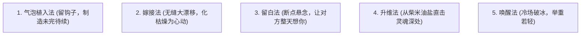

# 高维话题主导与情绪操控五大心法 (Advanced Conversation Steering)

> **“低水平聊天在被动回答问题，中等水平聊天在寻找共同话题，顶级猎手在主导情绪流动与定义谈话现实。”**

---

## 一、 话题掌控五大绝技



### 1. 气泡植入法 (Bubble Planting)
- **核心逻辑**：在陈述一件事的同时，不经意抛出 1-2 个充满诱惑的细节关键词（钩子），引导对方主动顺着关键词追问。
- **实战范例**：
  - ❌ 普通聊天：“今天跟朋友去吃了日料，味道挺好的。”（死路一条，对方只能回“哦/哪家”）
  - ✅ 气泡植入：“今天跟朋友去吃日料，中间发生了一件特别离谱的事，老板居然跑过来给我们免单了。”
  - 女生必问：“啊？为什么给你们免单啊？！” ➔ **聊天主动权完全落入你的陷阱**。

### 2. 嫁接法 (Topic Grafting)
- **核心逻辑**：从一个枯燥、公事公办的客观话题，瞬间无缝滑行到充满情感共鸣、生活情趣或暧昧张力的私人话题。
- **实战范例**：
  - 女：“今天加班改了一天 PPT，快累瘫了。”
  - ❌ 直男硬聊：“加班辛苦了，改完了吗？”（聊死）
  - ✅ 嫁接大师：“听起来今天被资本家狠狠压榨了。其实每次加班到深夜，我走出写字楼吹着冷风那一刻，都会特别想去街角那家老店喝一碗热气腾腾的牛杂汤。你呢，累到崩溃的时候，最想用什么奖励自己？”
  - **路径解析**：从“改PPT（枯燥事实）” ➔ “深夜冷风（感官体验）” ➔ “牛杂汤（生活犒劳）” ➔ “你的人生奖励机制（灵魂探索）”。

### 3. 留白法 (Zeigarnik Suspension)
- **核心逻辑**：利用蔡加尼克效应，在对话情绪最高潮、最快乐、最引人入胜的节点，突然找借口体面中断对话。
- **实战范例**：
  - 两个人聊得哈哈大笑、火花四溅时：
  - 男：“哈哈哈哈你这人脑洞真的有毒！不行了，我这边手头有个紧急合同要审，先不跟你贫了，去忙你的吧，晚上再来收拾你。”
  - **心理效果**：女生会一整个下午都沉浸在刚才欢快的余韵中，迫不及待等待晚上的“未完待续”。

### 4. 升维法 (Dimensional Escalation)
- **核心逻辑**：把琐碎的柴米油盐、吃喝拉撒，升维到对**性格、价值观、童年记忆或人生态度**的深度探讨。
- **实战范例**：
  - 女：“我平时周末就喜欢在家里宅着，哪也不想去。”
  - ❌ 低维直男：“宅在家里不无聊吗？多无聊啊。”
  - ✅ 升维大师：“其实你不是懒，你只是在工作日为了应付各种社交戴了太久的假面，一到周末，本能地想缩回自己的安全壳里，给自己的精神电量充满格，对吧？”
  - **心理效果**：一秒击穿防御，女生瞬间惊呼：“天呐，你怎么会这么懂我！”

### 5. 唤醒法 (Re-ignition Hook)
- **核心逻辑**：当话题彻底断掉、沉寂多日时，绝不尴尬地说“在干嘛”，而是用“场景联想”自然唤醒。
- **实战范例**：
  - 拍摄一张路过某家店的照片，或者一张可爱宠物的照片直接发送：
  - “刚才在路上看到这个，一秒钟串戏，感觉跟你上次跟我吐槽时的表情一模一样。”

---

## 二、 制造情绪过山车 (Emotional Rollercoaster) 的核心公式

```text
平静叙述 ──> 幽默打压/泼冷水 (跌入低谷) ──> 剧情反转/深情赞美 (冲上云霄) ──> 抽离留白 (回味无穷)
```

- **经典实操台词**：
  > “我发现你这个人毛病挺多的……（泼冷水）又傲娇，脾气又急，还总爱跟我抬杠。（跌入低谷）不过不知道为什么，看你气鼓鼓又拿我没办法的样子，我居然觉得挺可爱的。（冲上云霄）行了，别偷着乐了，下楼，带你去吃好吃的。（抽离带领）”
