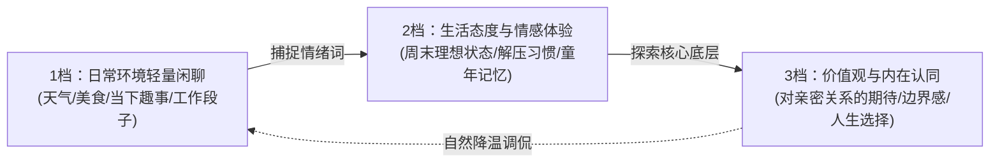

# 深度对话引导与话题跃迁技术 (Advanced Conversation Steering)

> **“浅层的闲聊只能交换信息，深度的对话才能交换灵魂。真正高维度的沟通，是在轻松日常中自然切入情绪与价值观，让彼此看见真实的内在世界。”**

---

## 一、 经典三层对话模型 (*Difficult Conversations* Framework)

哈佛谈判项目核心著作《关键对话》与《高难度对话》指出，任何深刻交流本质上都同时包含三层结构：

```text
┌────────────────────────────────────────────────────────┐
│ 1. 事实层面 (What Happened)：发生了什么客观事件、数据、安排 │
├────────────────────────────────────────────────────────┤
│ 2. 情绪层面 (The Feelings)：事件背后的感受、焦虑、渴望与脆弱 │
├────────────────────────────────────────────────────────┤
│ 3. 认同层面 (The Identity)：这对我意味着什么？我是一个怎样的人？│
└────────────────────────────────────────────────────────┘
```

### 1. 从事实层向情绪与认同层的“话题跳档”

很多男性聊天陷入“报菜名”和“查户口”的根源，在于永远被困在第 1 层（事实层）：
- ❌ **事实层死循环**：“在干嘛呢？” ➔ “加班呢。” ➔ “几点下班？” ➔ “十点吧。” ➔ “这么晚，吃晚饭了吗？”（极其枯燥疲惫）
- ✅ **向情绪与认同层跳档**：
  > **“十点才下班……感觉你对自己做事总有一股极强的责任感和韧劲。但今天这样连轴转，是不是整个人都在靠意志力硬撑？”**
  - **效果**：瞬间从无聊的事实推进到对对方**性格认同（责任感/韧劲）**与**当下深层脆弱情绪（硬撑）**的洞察与抚慰，引发强烈的情感共鸣。

---

## 二、 话题跃迁的三级变速齿轮 (The Three-Gear Shift)



### 1. 抓取“情绪锚点”实现丝滑转场 (Hook Catching)
不要刻意生硬地转换话题（如：“我们不聊这个了，来聊聊你的人生理想吧”），而是从对方句子中的**形容词、副词与情绪倾向**借力转场：

- **场景**：对方随口说：“今天去参加朋友婚礼，坐高铁快累瘫了，不过新娘哭的时候我也忍不住掉眼泪。”
- **提取锚点**：
  - 锚点 A（表层事实）：高铁很累。
  - 锚点 B（深层情绪与认同）：**“新娘哭的时候我也忍不住掉眼泪”**（高共情力、对亲密关系的感悟）。
- **转场范例**：
  > **“看别人幸福自己也会忍不住泪目的人，骨子里肯定特别重感情。你觉得两个人相处，最打动你的是盛大的仪式，还是日常里某个不起眼的小细节？”**
  - 对话立刻自然切入到**对亲密关系的价值观交流**。

---

## 三、 化解冷场与死胡同的四种高情商重构术

### 1. 绝不追问原则 (No Chasing in Dead Ends)
当对方回复单个字“嗯”、“哈哈”或表情包时，代表当前话题的能量已经耗尽。
- ❌ **错误动作**：“你怎么只回个表情？” / “还在忙吗？”（施加心理压力）
- ✅ **正确动作**：**主动释放压力，空窗留白**。在 4-8 小时后，用一个全新的独立高价值话题或趣图自然重启，如同无事发生。

### 2. 观察推测法代替查户口 (Observation & Deductive Guessing)
查户口让人警惕防御，冷读推测则让人觉得有趣好奇：
- ❌ **查户口**：“你是哪里人？平时喜欢做什么？平时几点睡？”
- ✅ **冷读推测**：“看你平时的穿搭和拍照角度，感觉你应该是个审美要求极高、甚至有点强迫症的细节控。”
  - 无论对方回答“哈哈被你猜中了”还是“完全不是”，对话空间都瞬间被彻底打开。

### 3. 承认尴尬并将其幽默化 (Owning the Awkwardness)
如果不小心说错话或遇到双方短暂失语：
- ❌ **心虚解释**：“我刚才不是那个意思，你别生气啊……”
- ✅ **幽默化解**：
  > **“完蛋，刚才这句话说完，空气突然安静得连外面的蝉叫声都听得见。容我喝口水重新组织一下语言。”**
  - 大方坦承自己的局促，展现出极强的心理弹性与安全感。

### 4. 边界探寻与安全回弹 (Respectful Redirection)
当涉及敏感隐私（如前任、收入、家庭矛盾）：
- **原则**：只听不说教，绝不八卦打听；若对方不想说，立即主动提供台阶。
- **示范话术**：
  > **“这部分听起来挺沉重的，如果不想聊没关系，随时喊停，今晚我们只负责开心。”**
