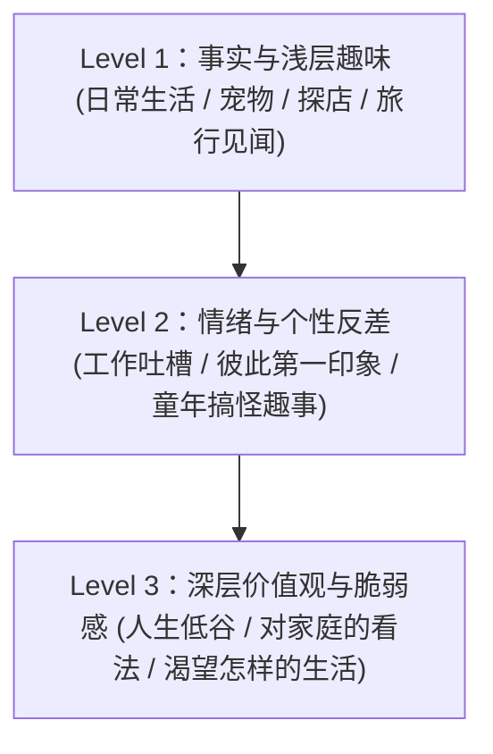

# 实战聊天、邀约与真实沟通手册 (The Authentic Escalation Playbook)

> **“聊天不是演戏，不是用精密的算法把对方诱骗进你的陷阱；而是两个独立而丰富的灵魂，在轻松的试探与博弈中确认彼此是否同频。”**

---

## 一、 破除不敢表达的心魔：意图与结果解绑 (Outcome Independence)

许多男性之所以在聊天和社交中极其被动、不敢挑明意图，本质是把“表达好感”当成了“乞求对方给自己发合格证”。

```text
┌────────────────────────────────────────────────────────┐
│ 匮乏心态（不敢表达）：                                    │
│ “如果我说想约她，她拒绝了我怎么办？那我在她面前就彻底丢脸了！”│
├────────────────────────────────────────────────────────┤
│ 丰盛心态（结果无关）：                                    │
│ “我觉得她很有趣，所以我大方发出邀请；                    │
│  她愿意来，我们一起享受美食；她没空，我做别的事情也同样精彩。” │
└────────────────────────────────────────────────────────┘
```

---

## 二、 破冰三部曲：告别“无聊查户口”与“油腻小可爱”

### 1. 核心公式：细节抓手 + 情绪微故事 + 零压力悬念
- **原则**：绝不发“在吗/吃了吗”，也绝不发十几年前的油腻套路。顺着对方刚提到的具体事实、动态或头像切入。

### 2. 真实对话三维对照表

| 场景 | ❌ 讨好型老好人模式 | ❌ 油腻套路小丑模式 | ✅ 成熟自洽高维模式 |
| :--- | :--- | :--- | :--- |
| **刚加上微信开场** | “你好呀小仙女，很高兴认识你！你平时喜欢做些什么呢？”（像在面试） | “成功捕捉一只野生小可爱，快到碗里来~”（极度油腻尴尬） | **“通过得挺快嘛，刚才偷偷蹲我呢？”**<br>*或：*<br>**“刚看你朋友圈那张滑雪照，姿势看着挺帅，没少摔吧？”** |
| **对方说“今天加班好累”** | “啊？加班这么辛苦啊，多喝热水，要不辞职算了，我养你！”（空洞画大饼） | “累就对了，谁让你脑子里全是我，能不累吗？”（不合时宜开黄腔） | **“当了一天打工人确实磨人。先别想工作了，晚上赶紧吃顿热乎的犒劳一下自己。”** |
| **发起周末约会邀请** | “那个……不知道你周末有没有时间……如果方便的话，能不能赏脸吃个饭？地方全听你的！”（卑微下跪） | “本霸总这周末翻你的牌子，打扮漂亮点，带你见见世面。”（虚浮油腻） | **“这几次跟你聊天挺开心的。周五晚上有空吗？我知道一家很棒的日料，想单独约你尝尝。”** |
| **邀约遭遇推脱/拒绝**<br>*（“这周有点忙，改天吧”）* | “啊……那下周呢？或者大下周？只要你哪天有空，我都随叫随到！”（死缠烂打） | “呵，果然女人都是口是心非的生物，不来拉倒。”（破防恼羞成怒） | **“行，那你先忙你的。改天有空再约。”**<br>*（说完立刻停止追问，转头专注于自己的生活）* |

---

## 三、 聊天情绪深入的三级阶梯

不能永远停留在柴米油盐的“吃了没/上班累”，也不能一上来就探讨人生意义。



### 1. Level 1 ➔ Level 2 的推进方式：从日常事实到感受共鸣
- 对方：“我平时周末就喜欢宅在家里看书或者拼积木。”
- ❌ 查户口式硬问：“你喜欢看什么书？拼的是什么牌子？拼了多久？”
- ❌ 玄学读心说教：“你表面宅，其实是为了应付复杂社交耗光电量、缩回安全壳里吧？”（缺少依据的主观臆测，油腻且冒犯）
- ✅ 感受承接与轻量延伸：
  > **“平时上班节奏太快，周末能在自己的步调里呆着最解压。最近有拼出什么大作吗？”**
  - **特点**：承接“解压”感受，尊重对方节奏，提问自然轻松，不搞心理诊断。

### 2. Level 2 ➔ Level 3 的推进方式：适度真诚敞开，不刻意卖惨
- 成熟男人的沟通态度：**不过度包装成无懈可击的完人，敢于平和分享真实的人生体会，但绝不大段倒苦水诉苦**。
  - 示例（聊到工作压力）：
  > “刚入行时我也经历过特别焦虑的阶段，后来发现与其焦虑未来，不如先把眼前手头这摊事做好。现在遇到卡壳，我就去跑步出出汗。”
  - 坦荡、从容、有自我调节能力，既真诚又能给予对方安全感。

---

## 四、 模糊邀约到闭环落地的阶梯推进

```text
第 1 步：模糊邀约（测试窗口期）
“最近城南新开了一家精酿小酒馆，据说爵士乐很绝，改天有空一起去坐坐。”
   │
   ├─► 若对方积极：“好啊！我也超喜欢爵士乐，什么时候去？” ──> 窗口大开！
   │     立即推进至第 2 步（确定邀约）。
   │
   └─► 若对方迟疑：“最近加班有点多，再说吧哈哈。” ──> 窗口未开。
         从容后撤：“哈哈我就随口一提，听说周末排队很夸张，等这阵热度过了再说。”（毫无挫败感）

第 2 步：确定邀约（二选一落地）
“这周五或者周六晚上，正好我有一段空档，晚上八点我顺路接你过去。”
（给出具体的二选一，而不是开放式无休止协商）
```
