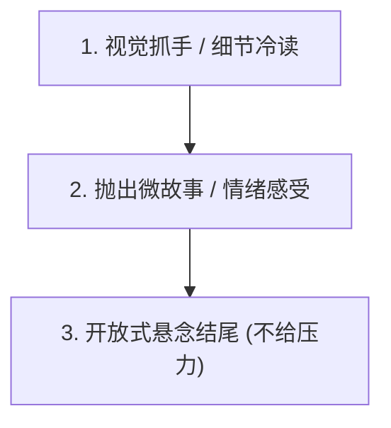

# 实战聊天与约会推进手册 (The Escalation Playbook)

> **“聊天不是为了证明你的口才有多好，而是为了让对方产生期待：‘真想跟这个有趣的男人面对面喝杯酒。’”**

---

## 一、 聊天破冰三部曲：拒绝查户口

### 1. 致命禁忌（直男无聊三连）
- ❌ “在吗？” / “在干嘛呢？”
- ❌ “吃了吗？” / “今天天气挺好。”
- ❌ 查户口式提问：“你多大了？老家哪里的？做什么工作的？”

### 2. 高胜率破冰模板



#### 模板 A：朋友圈细节冷读法（展示观察力）
- “刚刷到你动态，感觉你今天这身打扮走的是‘高冷御姐’风，但眼神出卖了你其实是个小吃货。”
- **心理机制**：巴纳姆效应，用反差细节激发好奇，女生百分之百会问：“哪里看出来的？”

#### 模板 B：场景情绪分享法（提供生活画面感）
- “刚才在咖啡店遇到一只胖得像猪一样的橘猫，一直在蹭我裤腿，那一瞬间突然觉得它长得有点像你（傲娇表情）。”
- **心理机制**：有画面感、有调侃、引发情绪波动与好奇反击。

#### 模板 C：无厘头情绪破冰（童氏风格）
- “完了，摊上大事了。”
- 女生：“怎么了？”
- “刚才走在路上突然打了个喷嚏，直觉告诉我肯定是你偷偷在背后念叨我。”

---

## 二、 聊天情绪升温三阶段

### 阶段 1：舒适感与信息互换（破冰 -> 熟悉）
- **核心**：分享生活状态，不压迫，多用陈述句代替夺命连环问。
- **话术公式**：**情绪感受 + 具体事实 + 你的态度**。
  - “今天加完班路上吹着晚风，突然觉得街边的烤红薯比米其林还治愈。”

### 阶段 2：暧昧张力与角色互动（熟悉 -> 心动）
- **核心**：引入推拉、曲解与轻度身体意识觉醒。
- **示例**：
  - 女生发了一张自拍。
  - 直男：“好美啊，仙女下凡！”（廉价捧杀）
  - 情感大师：“好看是好看，就是稍微有点显胖……不过挺好，捏起来手感肯定不错。”

### 阶段 3：预期铺垫与关系确权（心动 -> 奔现）
- **核心**：在文字中植入未来线下的画面预期（Future Projection）。
- **示例**：
  - “感觉你拍照技术应该挺烂的，下次出门看来必须我亲自出马给你当御用摄影师了。”
  - “下次去吃那家日料，你要是敢迟到，惩罚你全程给我剥虾。”

---

## 三、 邀约艺术：模糊邀约 ──> 确定邀约

千万不要一上来就确定时间地点（容易被拒且尴尬）。使用**两步递进法**：

```text
第 1 步：模糊邀约（测试窗口期）
“最近城南新开了一家精酿小酒馆，据说氛围绝了，改天有空一起去尝尝。”
   │
   ├─► 若女生回答：“好啊好啊 / 什么时候呀？” ──> 窗口大开！
   │     立即推进至第 2 步（确定邀约）。
   │
   └─► 若女生迟疑：“最近有点忙哎 / 再说吧。” ──> 窗口未开。
         从容后撤：“哈哈我也就随口一提，听说要排队两小时，等这阵热度过了再说。”（毫无挫败感）

第 2 步：确定邀约（闭环落地）
“这周五或者周六晚上，正好我有一段空档，八点我开车顺路捎你过去。”
（提供二选一的选择题，而不是“你哪天有空”的问答题）
```

---

## 四、 线下约会转场与肢体进挪 (Kino Escalation)

### 1. 转场黄金法则（多地点记忆嫁接）
- **心理学原理**：如果一个晚上你们在 3 个不同场景转场（餐厅 -> 漫步江边/公园 -> 沉浸式清吧/桌游），女生在潜意识里会觉得“已经和你度过了好几个不同的时光”，情感黏性呈几何级数增加。

### 2. 肢体接触进挪阶梯 (Kino Escalation Ladder)

```text
阶梯 5：深度亲密 (接吻 / 拥抱) ── 需要私密安静环境与眼神深情聚焦
  ▲
阶梯 4：牵手 / 搂肩 ── 借过马路或转场自然牵起，看对方是否回握
  ▲
阶梯 3：轻度身体接触 ── 并排走时手臂碰撞、看手机时靠近闻发香
  ▲
阶梯 2：道具借力 ── 帮她擦嘴角油渍、顺一下乱了的头发、看手相
  ▲
阶梯 1：无意触碰 ── 递咖啡时指尖碰到、打闹时轻轻碰她手臂
```

- **进挪核心法则：试探 -> 观察反馈 -> 升级或暂停**。
  - 若女生不躲闪甚至微笑迎合，说明绿色信号，继续升级；
  - 若女生身体微僵或退缩，**立刻若无其事退回上一级**，保持绅士松弛，绝不尴尬追赶。

---

## 五、 危机与假性放弃：冷淡期的破局绝杀

### 1. 当女生突然态度冷淡、隔天回、字数变少
- **绝对不要做的事**：
  - “怎么了？你今天不开心吗？”
  - “是不是我做错什么惹你生气了？”
  - 疯狂长文本解释。
- **正确的应对策略：断崖式降温（冷冻处理）**：
  - 停止发任何主动关心的消息，把对话留白 3-7 天。
  - 同步在朋友圈建设高品质动态（聚会、运动、事业、搞怪、生活美学，绝不发伤感文案）。
  - **重启时机**：找到全新的第三方有趣话题，像完全没发生过冷战一样轻松开场：“今天路过那家你提过的甜品店，果然难吃得名不虚传，差点被你坑了。”
