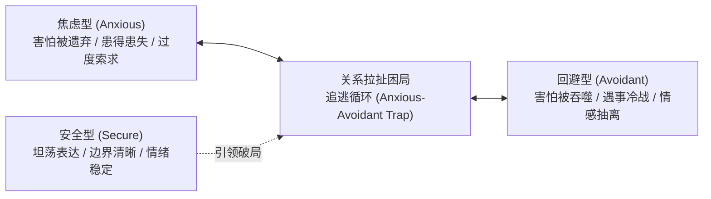

# 沟通理解与深层心理动力学 (Female & Relational Psychology)

> **“沟通的致命误区，是用自己的防御去触碰对方的防御。看清表象背后的依恋渴求与情绪信号，才能建立真正成熟的亲密关系。”**

---

## 一、 语言双轨制：逻辑层 vs 情绪容器

在亲密沟通中，男女之间最常见的脱节在于认知轨道的错位：

```text
┌────────────────────────────────────────────────────────┐
│ 男性常见本能（单轨）：输入问题 ──> 寻找方案 ──> 输出解决结论 │
├────────────────────────────────────────────────────────┤
│ 女性常见表达（双轨）：表面言语 ──> 情绪投射 ──> 寻求连接确认 │
└────────────────────────────────────────────────────────┘
```

### 1. 经典对话对比
- **场景**：对方说：“今天部门汇报被领导当众批评了，烦死了！”
- ❌ **机械说理模式（激化矛盾）**：
  > “他为什么批评你？其实站在管理层角度，你这份 PPT 确实数据不够严谨，下次改掉就行了。”
  - **心理后果**：对方感到被孤立和被评判，将你与批评她的领导划归一伙，沟通通道瞬间封死。
- ❌ **油腻套路模式（轻浮冒犯）**：
  > “哪个没长眼的敢欺负我家小宝贝？看我明天去把他公司砸了给你出气。”
  - **心理后果**：关系不熟时极度油腻尴尬，完全忽视了对方实际面对的职业现实。
- ✅ **成熟承接模式（先做容器，再看是否需要建议）**：
  > **“当众被批确实太憋屈了。先别想工作了，晚上想吃点什么犒劳一下自己，想吐槽随时跟我说。”**
  - **临床原理**：**先承接情绪（提供安全感）➔ 再陪伴转移注意力 ➔ 对方主动询问时才给建议**。

---

## 二、 成人依恋动力学 (Adult Attachment Dynamics)

根据约翰·鲍尔比（John Bowlby）与埃米尔·莱文（Amir Levine）的研究，亲密关系中的大部分内耗源于**依恋风格的错位**，而非道德或人品问题。



### 1. 三大依恋风格在日常沟通中的具体表现

| 依恋类型 | 核心恐惧 | 典型行为与言语特征 | 常见错误应对 | 成熟破局方案 |
| :--- | :--- | :--- | :--- | :--- |
| **焦虑型 (Anxious)** | 害怕被抛弃、被冷落 | - 频繁确认“你还在乎我吗”<br>- 启动“抗议行为”（故意晚回、赌气、说反话）<br>- 回复慢就灾难化联想 | 觉得对方不可理喻而直接冷战回避，导致对方彻底抓狂 | **给予明确的时间确定性**：“我手头有紧急工作，先忙 2 小时，下午 4 点忙完立刻找你。” |
| **回避型 (Avoidant)** | 害怕失去独立性、被控制 | - 关系稍有升温就本能后撤<br>- 遇到分歧立即拉下脸沉默（Stonewalling）<br>- 强调“我需要个人空间” | 疯狂连环追问、堵门、发小作文逼对方表态（触发其逃跑本能） | **尊重其物理空间，不追赶**：“看你今天状态很累，先好好休息，等你休息好了我们再聊。” |
| **安全型 (Secure)** | 相信自己值得被爱，信任他人 | - 直接坦诚表达需求与边界<br>- 能就事论事，不翻旧账<br>- 既享受亲密，也安于独处 | / | **坦荡对等投入**：有话直说，以诚相待，共同规划未来。 |

---

## 三、 情感勒索 (Emotional Blackmail) 与 FOG 机制

源自苏珊·佛沃（Susan Forward）的临床研究。必须清晰区分**“伴侣的不成熟情绪撒娇”**与**“真正的精神控制”**：

### 1. FOG 操纵模型
情感勒索者通常通过引发受害者内心的三种毒性情绪来迫使其放弃边界：
1. **恐惧 (Fear)**：“你要是敢去跟朋友聚会，我们就分手！”
2. **责任 (Obligation)**：“作为男朋友，你难道不应该无条件满足我吗？”
3. **内疚 (Guilt)**：“我今天心情这么差都是因为你，你真自私！”

### 2. 应对情感勒索的 SOS 临床准则
- **S (Stop) 停下来**：面对勒索要求，绝不当场妥协答应，也不当场暴怒反击。
- **O (Observe) 观察**：在心里对自己说：“她正在试图用内疚感操控我，我有权利说不。”
- **S (Shift) 转移**：使用非防御性语言明确拒绝：“我理解你希望我留下来陪你，但我今晚确实有重要安排，这不代表我不爱你。我们明天再见。”

---

## 四、 女性情感投标 (Bids for Connection) 的识别与承接

源自约翰·戈特曼（John Gottman）西雅图爱情实验室的实证研究。伴侣之间能否长久，取决于日常微小的情感互动：

* **什么是情感投标**：对方随口说的琐碎日常（如：“你看窗外那只鸟好奇怪”、“今天这杯奶茶味道有点淡”）。
* **三种回应方式的致命差距**：
  1. **背向回应 (Turning Away)**：头也不抬，继续看手机毫无反应。（**最致命，关系的隐形杀手**）
  2. **逆向回应 (Turning Against)**：“这有什么好看的，少见多怪！”（引发防御与争吵）
  3. **迎向回应 (Turning Toward)**：抬头看一眼，笑笑说：“真的哎，头上的毛怎么是翘着的。”（**极速建立长期情感账户**）
