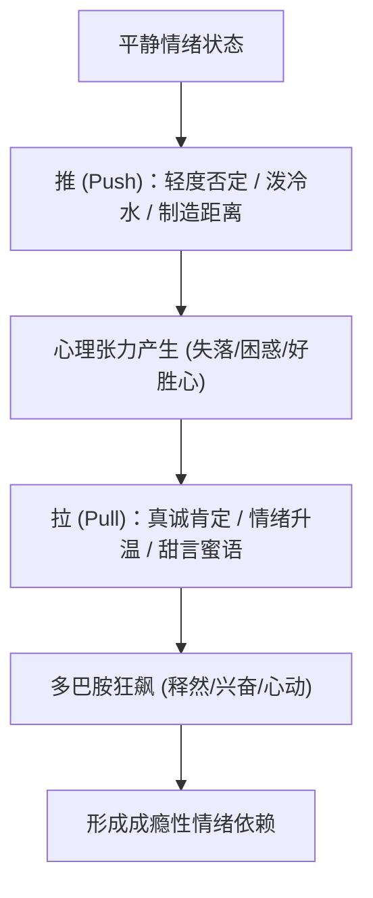

# 推拉心法与框架掌控：童氏哲学与高级吸引力机制

> **“我可以为你心动三秒，但我随时能够优雅抽离。你可以倾国倾城，但我绝不会在你的剧本里当群演。”**  
> **—— 童氏框架核心灵魂**

---

## 一、 框架理论 (The Frame Principle)：掌控现实定义权

### 1. 什么是框架？
在两性交流中，**谁在寻求对方的认可，谁就处于下位框架；谁在定义互动的标准与节奏，谁就掌控主导框架。**

```text
弱势框架（舔狗）：
“她觉得我怎么样？” ──> “我该怎么回复才能让她高兴？” ──> “千万不能惹她生气。”

强势框架（高维猎手）：
“我觉得她性格怎么样？” ──> “她配不配进入我的生活？” ──> “如果聊得无聊，随时换下一个。”
```

### 2. 框架博弈的三大实战法则
1. **绝不自证 (Never Justify Yourself)**：
   - 当对方质疑你、挑衅你时，解释就是认输，自证就是被动。
   - 对方：“你这人怎么这么自恋？”
   - 弱框架：“没有啊，我其实只是比较自信而已。”
   - 强框架：“没办法，每天早上照镜子都被自己迷倒，我也很苦恼。”
2. **反向筛选 (Reverse Qualification)**：
   - 将“被挑剔”转变为“挑剔对方”。
   - “长得好看的女孩子很多，但像我这样脾气好又有品味的，得看你懂不懂珍惜了。”
3. **打破对等回应**：
   - 对方发一句话，你回三段长篇大论 = 价值倒贴。
   - 永远保持**文字量对等甚至略少**，节奏感由你掌控。

---

## 二、 童氏心法五大图腾 (Tong's Playbook)

### 1. 松弛感与痞帅幽默 (Playful Detachment)
- **核心**：不紧绷，不严肃，不把聊天当成高考面试。把所有问题当成一场好玩的游戏。
- **要领**：嘴上带点坏，眼神带点笑，随时准备自嘲，不玻璃心。

### 2. 随时抽离力 (Abundance Mindset)
- 心理根基：**“得之我幸，不得我换”**。
- 只有当你不在乎失去一个人的时候，你在她面前的魅力才会达到峰值。你的患得患失，在女生敏锐的直觉里就是虚弱无能。

### 3. 曲解术 (Misinterpretation) —— 无解的调情杀手锏
把女生的任何言行，都往“她暗恋你”、“她想占你便宜”、“她在吃醋”的方向幽默曲解。
- 女生：“你今天穿得挺帅啊。”
  - 曲解：“收起你色眯眯的眼神，光天化日的，我是正经人。”
- 女生：“你是不是又去喝酒了？”
  - 曲解：“这么关心我？是不是偷偷查我岗呢，小管家婆？”
- 女生：“你真讨厌！”
  - 曲解：“一般女生说讨厌，潜台词都是太喜欢了拔不出来。”

### 4. 角色扮演 (Role-Play Framing)
瞬间构建一个微型剧本，快速打破陌生人界限：
- 场景一：**“冷酷霸总与傲娇秘书”**
  - “今天表现不错，下个月给你的秘书津贴翻倍。”
- 场景二：**“假装办离婚 / 婆媳关系”**
  - “我们三观严重不合，明天民政局门口见，财产归我，猫归你。”
- 场景三：**“后宫争宠”**
  - “表现这么积极，看来今年打入正宫的位置有望了。”

---

## 三、 推拉艺术 (Push & Pull) 四大维度

推拉的本质是：**制造情绪落差，引发心跳加速，打破平淡叙事**。



### 1. 语言推拉：否定 + 肯定
- **先推后拉**：
  - “你今天这身衣服真的一般……（推）不过不知道为什么，穿在你身上居然该死的好看。（拉）”
  - “你性格其实挺任性的……（推）但我就吃你这一套，真拿你没办法。（拉）”
- **先拉后推**：
  - “你眼睛真的好漂亮，像有星星一样……（拉）要是视力再好点，能看清我对你的好就更完美了。（推）”
  - “刚才那一瞬间我差点对你动心了……（拉）还好我掐了自己大腿一下，及时清醒了过来。（推）”

### 2. 行为推拉：热情 + 抽离
- 聊得最火热、情绪最高峰的时候，**主动中断对话**：
  - “突然有点紧急事情要处理，先不跟你贫了，乖乖去忙，晚上再翻你牌子。”
- **心理学效应（蔡加尼克效应 Zeigarnik Effect）**：
  - 人对未完成的事情记忆最深。在最快乐的高潮戛然而止，她会整整想你一下午。

### 3. 时间推拉：节奏掌控
- 对方秒回，你不必刻意卡几小时，但绝不随时随地秒回。
- 偶尔秒回展示激情，偶尔隔 20-40 分钟展示生活充实，**打破确定性奖励回路（间歇性强化）**。

---

## 四、 实战避坑指南

1. **推拉不是人身攻击**：
   - 调侃要针对**外在修饰、性格小傲娇、可爱的小缺点**，严禁攻击别人的生理缺陷、原生家庭或尊严底线。
2. **推拉要有张有弛**：
   - 推得太多是刻薄低情商（油腻 Negging）；拉得太多是讨好舔狗。
   - **黄金比例**：拉 70% + 推 30%。推是调味剂，拉才是最终落脚点。
