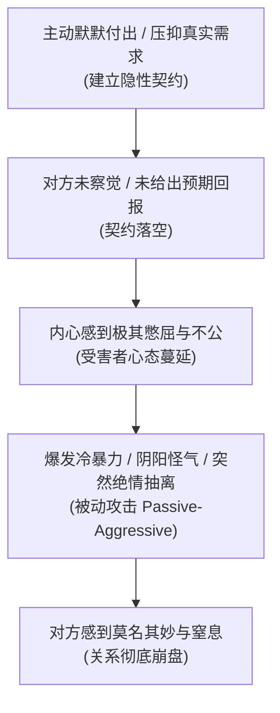

# 成熟高框架与健康推拉艺术 (Mature Framing & Push-Pull Dynamics)

> **“最高级的吸引力不是装出来的冷漠，而是极度的松弛、自洽与坦荡。有能力全心投入，也有底气随时从容抽离。”**

---

## 一、 框架理论的真谛：从“脆弱虚假强者”到“内核自洽”

在两性博弈与亲密关系中，所谓**框架 (Frame)**，不是居高临下的控制欲，也不是油腻的“霸道总裁”人设。

```text
┌────────────────────────────────────────────────────────┐
│ 弱势讨好框架（老好人）：                                  │
│ “她今天回消息慢了，是不是我不够优秀？我该怎么表现才能讨她欢心？”│
├────────────────────────────────────────────────────────┤
│ 虚假自负框架（低端装逼）：                                │
│ “女人必须听我的！我绝不低头，低头就输了，我要打压她。”         │
├────────────────────────────────────────────────────────┤
│ 成熟高维框架（奖品心态 / 内核自洽）：                      │
│ “我真诚地欣赏你，但我有我热爱的事业和完整的个人生活；          │
│  我们在一起是锦上添花，你若离开我也依然完整充实。”             │
└────────────────────────────────────────────────────────┘
```

---

## 二、 彻底破除“老好人隐性契约” (Covert Contracts)

源自罗伯特·格洛弗（Robert A. Glover）《别再当好好先生》的核心诊断。这是 90% 男性在感情中沦为舔狗、患得患失并最终爆发被动攻击的终极根源。

### 1. 隐性契约的三大典型剧本
1. **剧本一**：“如果我足够体贴温柔、百依百顺、从不发脾气，你就必须全心全意爱我，不能冷落我。”
2. **剧本二**：“如果我不计成本地为你付出、揣摩你的每个心思，你就应该像肚子里的蛔虫一样主动满足我的需求，而不需要我开口。”
3. **剧本三**：“如果我做个完美的好男人，我就应该拥有一帆风顺的感情生活，不受到任何伤害。”

### 2. 隐性契约的毒性循环圈



### 3. 撕毁隐性契约的实操法则
- **原则一：严禁“为了索取回报而付出”**。问自己：“如果她对我这次付出没有任何感动、也不给我任何回馈，我还愿不愿做这件事？”如果答案是“不愿意”，立刻停止去做！
- **原则二：把“猜心暗语”变成“明示需求”**。
  - ❌ 错误（生闷气）：“你昨天一天没理我，我今天也不理你，看你着不着急。”
  - ✅ 正确（直接表达）：“昨天一整天没收到你的消息，我心里有点失落。如果忙，提前跟我说一声，免得我担心。”

---

## 三、 真实脆弱感与意图表达 (Radical Honesty & Vulnerability)

源自马克·曼森（Mark Manson）《Models》的非传统交往哲学：**“敢于暴露自己真实的喜好、欲望与边界，才是雄性最高级的自信。”**

### 1. 为什么“套路”比不过“坦荡”？
- 套路和所谓“搭讪话术”本质上是在向外界传递一个信号：“真实的我配不上你，所以我必须戴上一副精美的面具来骗取你的好感。”
- 真正的从容男人拥有**“结果无关性（Outcome Independence）”**：
  - 我表达我的喜欢，是因为你值得被欣赏，而不是乞求你给我发合格证；
  - 你若接受，我们携手享受旅途；你若拒绝，我祝福你并继续热爱我的生活。

### 2. 实战对话示范
- **场景**：想要推进关系、约心仪的女生周末单独见面。
- ❌ **套路伪装流**：“我朋友刚好给了我两张展览门票，我一个人去挺浪费的，你顺便陪我去一趟呗。”（找虚假借口掩盖意图）
- ❌ **卑微乞讨流**：“求你了小仙女，赏个脸陪我吃顿饭吧，去哪全听你的！”（丧失框架）
- ✅ **坦荡真诚流**：
  > **“这几次跟你聊天挺开心的，周五晚上有空吗？我知道一家很棒的西餐厅，想单独约你一起吃个饭。”**

---

## 四、 健康推拉 (Push-Pull) 的四大维度

推拉的真正目的不是贬低对方，而是**打破客套与沉闷，创造心跳加速的微幅情绪起伏与亲密张力**。

### 1. 语言维度的轻度推拉（打一巴掌揉一揉）
- **公式**：**轻度调侃/否定（推） + 细节肯定/拉近（拉）**
- **示范**：
  - “你今天这身打扮确实有点高冷御姐的架势……（推）不过第三张照片里那个小表情，彻底出卖了你其实是个小逗比。（拉）”
  - “你这脾气确实挺任性的……（推）但不知道为什么，我就吃你这一套，真拿你没办法。（拉）”

### 2. 行为维度的推拉（热情投入 + 体面留白）
- 聊天聊到情绪最高峰、笑得最开心的时候，**主动体面中断对话**：
  > “哈哈哈哈你这脑洞真的绝了！不行，我手头有个紧急合同要审，先不跟你贫了，去忙你的吧，晚上再来收拾你。”
- **心理机制（蔡加尼克效应）**：人对未完成的事件记忆最深。在高潮戛然而止，她会整整回味你一下午。

### 3. 时间与节奏的推拉（呼吸感）
- 严禁固定卡表（如“必须等 8 分钟才回”——机械愚蠢）；
- 顺其自然：空闲时可以秒回畅聊，忙碌时专注工作几小时后再回，保持生活真实的“呼吸感”。

### 4. 幽默自嘲与曲解术
- 将女生的质疑，幽默曲解为她在“吃醋”、“暗恋你”或“撒娇”：
  - 她：“你今天怎么穿得这么帅？”
  - 你：“收起你崇拜的眼神，光天化日的，我是正经人。”
