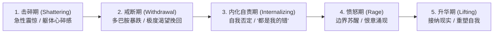

# 冲突消解、冷场应对与失恋复原全手册 (Conflict, Recovery & Breakup Healing)

> **“关系的试金石不在于一帆风顺时的甜言蜜语，而在于激烈冲突时能否稳住阵脚、遭遇冷落时能否保有尊严、面对终局时能否体面重生。”**

---

## 一、 日常冷场与假性冷淡的科学应对

```text
┌────────────────────────────────────────────────────────┐
│ 假性冷淡 (Soft Freeze)：                                 │
│ 表现：回复字数变短、间隔从几分钟变成数小时、语气平淡        │
│ 本质：需求感过度暴露导致社交窒息，或话题枯竭产生倦怠感      │
└────────────────────────────────────────────────────────┘
```

### 1. 黄金止损法则：禁止四连送命操作
- ❌ **严禁夺命追问**：“在干嘛呢？怎么不理我了？是不是我说错什么了？”
- ❌ **严禁长篇自省小作文**：几千字的情感剖白只会让对方感到窒息与沉重。
- ❌ **严禁报复性赌气**：故意憋着几天不回，等对方发消息时阴阳怪气。
- ❌ **严禁廉价献殷勤**：疯狂点外卖送花，暴露出“靠花钱讨好”的低位姿态。

### 2. 自然留白与重心回归
- **动作**：发送一条轻松的收尾表情或简短回复后，**自然结束当前话题，将注意力收回自己的生活与工作中**。
- **避免机械冷冻**：**不搞“必须数着天数冷冻几天”的刻意博弈**。给彼此留出呼吸空间，也打破对方“你没有独立生活”的焦虑感。
- **无压力重启破冰**：
  - 必须围绕**客观、有趣、第三方的真实生活切入点**，绝不提“好久没联系”、“怎么不理我”：
  - *“今天路过你之前提过的那家可颂店，排队排到马路牙子上了，果然难买。”*
  - 对方若正常接话，顺势自然聊；若依然冷淡，**再次自然打住，不追加任何追问，不反复纠缠**。

---

## 二、 激烈冲突消解与破除“逃跑/冷战”本能 (Gottman & Stone 临床体系)

多数男性在面临伴侣剧烈情绪发难时，本能反应是“闭嘴、摔门逃跑、开启冷战”。在心理学上，这被称为**情绪泛滥（Flooding）**。

### 1. 情绪泛滥的生理机制
- 当争吵加剧时，男性体内的肾上腺素激增，心率往往瞬间突破 **100 次/分钟**。
- 此时交感神经全面接管，大脑负责理性逻辑的额叶皮层暂时“断电”，生理本能只剩下两件事：**打（暴力回击）** 或 **逃（冷暴力逃避）**。

### 2. 战术安全暂停卡（必须包含：状态 + 离开动作 + 明确归期）
- ❌ **错误逃跑（恶性冷暴力）**：“你不可理喻，随便你吧！”（摔门而出，失联失踪）
- ✅ **标准安全暂停剧本（保护关系，给彼此降温）**：
  > **“我现在情绪非常紧绷，心跳很快，再争下去容易说出伤人的狠话（说明生理状态）。我需要去楼下散步 20 分钟冷静一下（说明动作），8 点 40 分我一定准时回来，我们坐下来好好说（承诺归期与解决意图）。”**
- **执行纪律**：散步期间严禁进行“受害者反刍”（在脑子里反复骂对方多过分），只做深呼吸调整心率；**掐好表，时间一到必须准时返回现场！**

### 3. 平复归来后的“学习型对话开场”（来自哈佛谈判项目《高难度谈话》）
回到现场，倒一杯温水递给她，坐下来看着眼睛：
> **“刚才我态度有点冲。关于这件事，我想先听听你刚才的感受和最难受的点。你先说，我认真听，不打断。”**

### 4. 戈特曼（Gottman）核心冲突修复金句库 (Repair Attempts)
在争吵僵持不下时，主动抛出一张“修复卡”能瞬间阻断冲突升级：
1. **“我知道这很让人沮丧，但我们可以慢慢说。”**
2. **“刚才那句话我说得有点难听，对不起，我不是那个意思。”**
3. **“我们能暂停一分钟吗？我有点听不清你在说什么了，我想好好听。”**
4. **“我真的很爱你，我不想把这件事变成一场我们俩之间的战争。”**
5. **“其实你刚才说的某个观点是有道理的，是我太固执了。”**

---

## 三、 真性分手、被抛弃感与自我复健 (Susan Anderson & Kristin Neff 体系)

面对真正的不可调和、背叛或断崖式分手，男性的恢复是一场**真实的神经化学与心理重塑工程**。

### 1. 丧失与哀伤的五阶段规律


### 2. 严格执行“无接触原则” (No Contact Rule)
- **真谛**：无接触不是为了“欲擒故纵逼她回头”，而是给大脑受损的多巴胺神经通路做**外科手术式的隔离缝合**。
- **铁律**：
  - 彻底封存聊天记录、相册；
  - 严禁深夜偷窥对方社交动态；
  - 严禁假借“归还物品”等借口试图制造偶遇；
  - 遇到必须交接的现实事务（如退房、合同），只就事论事，言尽于此。

### 3. 正念自我关怀三步法（阻断毒性自我否定）
当深夜自责反刍袭来（“如果我当初多挣点钱/脾气更好，她就不会走”）：
1. **正念觉察**：“我现在感到胸口很闷、很痛苦，这是失去挚爱时正常的生理悲伤反应。”
2. **普遍人性**：“全世界每天有成千上万的人经历分手的痛苦，我不是唯一失败的人，痛苦是人类共有的体验。”
3. **自我善待**：把手放在胸口，对自己说：“分开是因为我们两套人生系统在现实中无法良好协作，这不否定我的全部价值。我允许自己难过，我依然会好好照顾自己。”
