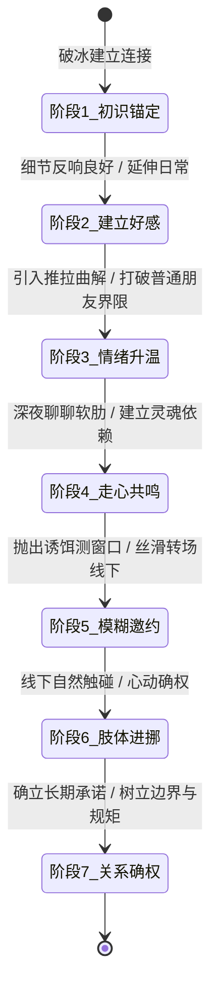

# 7 阶段关系推进全景引擎 (7-Stage Escalation Engine)

> **“在错误的时间做正确的事，也是一场灾难。把控亲密关系的节拍，既不盲目冒进暴露需求感，也不畏首畏尾错失窗口，更要在触碰红线时坚决止损。”**

---

## 阶段推进全景状态机

---

## 各阶段实战核心指标与信号雷达

### 阶段 1：初识与身份锚定 (Initial Anchoring)
* **核心目标**：消除陌生防御戒备，建立“有趣、有边界、不跪舔”的第一印象，绝不沦为通讯录里的僵尸号。
* **信号雷达**：
  - 🟢 **绿灯 (IOI)**：积极接抛出的话题，使用语气词（“哈哈/真的吗”），主动反问。
  - 🟡 **黄灯 (观望)**：礼貌简短回复，不主动延伸，属于客套社交。
  - 🔴 **红灯 (降权)**：连续已读不回超 24 小时，仅发冷淡表情包敷衍。
* **典型误区**：查户口三连问（“多大了/哪里人/单身吗”），机械早安晚安打卡。

### 阶段 2：相互了解与价值展示 (Attraction & Value Demonstration)
* **核心目标**：展示真实的个人生活情调与事业专注面，激发对方的探索欲。
* **信号雷达**：
  - 🟢 **绿灯 (IOI)**：翻看你的朋友圈并主动提及细节，好奇你的行程与爱好。
  - 🟡 **黄灯 (观望)**：有问必答，但从不主动打听你的生活。
  - 🔴 **红灯 (降权)**：无论你分享什么，只回“哦/厉害”并迅速终结话题。
* **典型误区**：刻意炫耀名表跑车（暴发户俗气），急于向对方证明自己配得上她。

### 阶段 3：轻松调侃与情绪升温 (Escalation & Push-Pull Testing)
* **核心目标**：引入推拉、曲解与微弱的男女意识，打破“普通老好人”的友谊区 (Friend Zone)。
* **信号雷达**：
  - 🟢 **绿灯 (IOI)**：接得住你的调侃，甚至反向开玩笑调戏你，主动发自拍或分享生活糗事。
  - 🟡 **黄灯 (观望)**：被调侃后出现迟疑，转移到严肃话题。
  - 🔴 **红灯 (降权)**：严肃反感（“别开这种玩笑，我们没那么熟”）。
* **典型误区**：开低俗黄色玩笑（直接沦为猥琐男），在对方心情不好时硬玩梗。

### 阶段 4：情感共鸣与走心连接 (Comfort & Deep Connection)
* **核心目标**：从表面调情下沉到价值观与情绪连接。通过率先展示微小脆弱感，成为对方的情绪安全容器。
* **信号雷达**：
  - 🟢 **绿灯 (IOI)**：主动在深夜找你倾诉生活烦恼、原生家庭、过往伤痛，发长语音。
  - 🟡 **黄灯 (观望)**：只聊职场或日常琐事，回避私人情感经历。
  - 🔴 **红灯 (降权)**：对你的深层分享敷衍以对。
* **典型误区**：化身怨男倒苦水（丧失雄性力量感），在对方倾诉时急于当爹式说教。

### 阶段 5：模糊邀约与线下转场 (Low-Pressure Closing)
* **核心目标**：将线上好感无痛迁移至线下实体空间，实现低被拒率、高期待感的一次约会落地。
* **信号雷达**：
  - 🟢 **绿灯 (IOI)**：当你提及某家店或展览时，她主动说“哇我也想去/改天带我”。
  - 🟡 **黄灯 (观望)**：“看起来不错，下次有机会再说吧。”
  - 🔴 **红灯 (降权)**：“我周末都很忙，不怎么出门。”
* **典型误区**：直接生硬发问：“你周末有空吗？能约你吃个饭吗？”（给对方巨大的心理压力）。

### 阶段 6：双向亲密与肢体进挪 (Kino Escalation)
* **核心目标**：线下约会中逐步突破物理防御，从社交距离自然过渡到亲密距离。
* **信号雷达**：
  - 🟢 **绿灯 (IOI)**：过马路牵手不甩开且有回握、并排走肩膀紧贴、对视眼神含羞。
  - 🟡 **黄灯 (观望)**：触碰时身体微僵但未明显拉开距离（观望心理）。
  - 🔴 **红灯 (降权)**：下意识迅速闪躲、拉开物理距离、整理包包建立物理屏障。
* **典型误区**：在嘈杂混乱的公开场合猴急强吻；遭遇拒绝后恼羞成怒。

### 阶段 7：关系确权与健康边界 (Commitment & Healthy Boundaries)
* **核心目标**：在心动高位顺理成章完成长期关系确权，不是通过卑微乞求表白，而是确立对等的爱与边界。
* **信号雷达**：
  - 🟢 **绿灯 (IOI)**：主动向闺蜜朋友介绍你、发朋友圈带有你的痕迹、在意你的异性界限。
  - 🟡 **黄灯 (观望)**：享受亲密互动但回避公开关系或拒绝明确身份（养鱼嫌疑）。
  - 🔴 **红灯 (降权)**：事后突然冷淡、抽离。
* **典型误区**：搞大张旗鼓的道德绑架式表白；确权后瞬间失去自我，沦为随叫随到的保姆舔狗。
