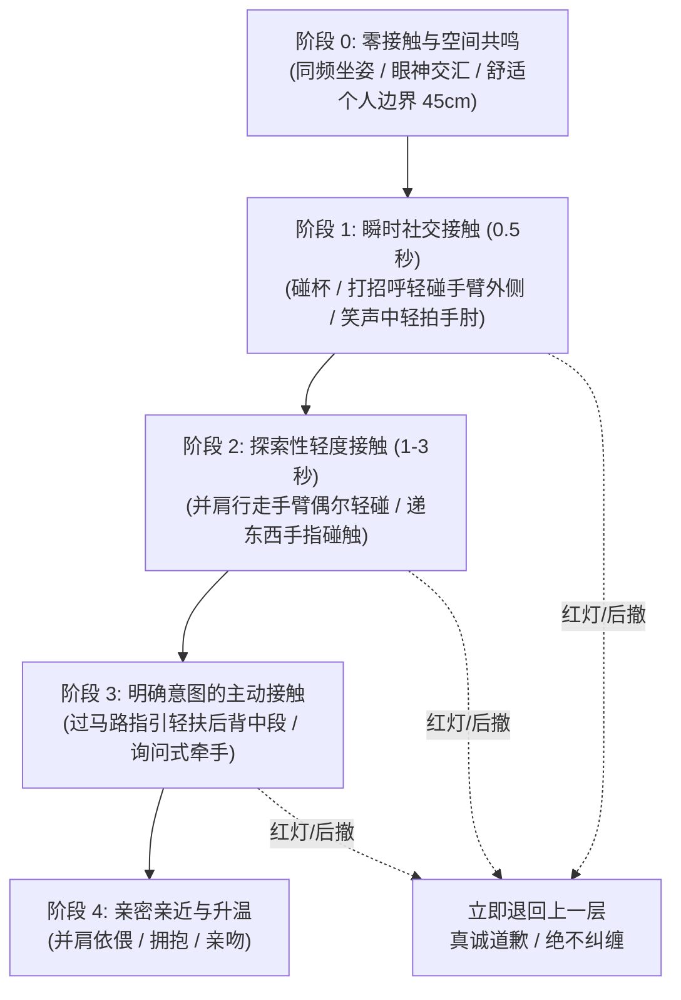

# 信号解码、体态语言与亲密接触阶梯 (Signals & Physical Attunement)

> **“真正的吸引力不需要借口试探，成熟的亲密接触建立在知情同意、体态共鸣与情绪安全感之上。身体接触是情感连接的自然延伸，而非攻城略地的征服游戏。”**

---

## 一、 信号矩阵：从可见行为到意愿判断

在两性交往中，最大的误区是将“友善”、“社交礼貌”或“倾诉”误判为“性/浪漫吸引”，或反过来把“慢热”、“回避”当作“欲拒还迎”。

```text
┌──────────────────────────────────────────────────────────────────┐
│  红绿灯信号系统 (Traffic Light Attunement Model)                 │
├──────────────────────────────────────────────────────────────────┤
│ 🟢 绿灯（主动开放）：主动延伸个人话题 / 身体前倾 / 眼神锁定微笑 /   │
│                   主动寻找物理靠近 / 欣然接纳试探性接触        │
├──────────────────────────────────────────────────────────────────┤
│ 🟡 黄灯（社交礼貌/中立观察）：礼貌回答但少提问 / 坐姿端正保持距离 / │
│                             回复简短客气 / 暂未排斥但无主动升级 │
├──────────────────────────────────────────────────────────────────┤
│ 🔴 红灯（阻断与不适）：身体后仰 / 双臂抱胸 / 频繁看手机 / 身体僵硬 /│
│                   言语拒绝 / 刻意回避视线 / 后退缩手           │
└──────────────────────────────────────────────────────────────────┘
```

### 1. 常见行为的心理学解码

| 表面行为 / 现象 | ❌ 常见过度解读（老好人/油腻妄想） | ✅ 客观事实与心理动因 | 成熟应对方案 |
| :--- | :--- | :--- | :--- |
| **深夜倾诉烦恼** | “她半夜找我，肯定爱上我了，在暗示我可以表白。” | **情绪求助或孤独投射**。可能仅信任你的情绪容器价值，尚未产生浪漫吸引。 | 给予温和倾听与陪伴，不急于趁虚而入或借机表白，观察白天互动是否依然对等。 |
| **秒回消息 / 发自拍** | “绝对是我的迷妹，测试她一下！” | **当下无聊、社交习惯或分享欲**。自拍可能群发或发动态顺手发送。 | 轻松赞美并自然接话，不因此盲目推进身体接触或强行暧昧。 |
| **肢体轻碰后没有躲闪** | “她默认了！我可以顺势强吻或直接搂腰了。” | **处于轻度惊愕、反应延迟或社交顺从**。未躲避不等于知情同意。 | 观察其后续眼神与面部肌肉松弛度，循序渐进，给对方明确的主动选择空间。 |
| **身体僵硬、收缩、下意识抽手** | “她在害羞，女人都是口是心非，越反抗越要强硬。” | **处于应激、不适或防备状态**。典型的边界警报信号。 | **立即停止任何物理推进，后撤半步，平静化解**：“抱歉，刚才冒昧了，我们慢慢来。” |

---

## 二、 现代非强迫性接触阶梯 (Non-Coercive Touch Escalation)

传统的街头搭讪技巧常推荐所谓的“过马路顺势拉手”、“看手相顺手摸手”、“故意打赌刮鼻子”等伪装套路。这些套路在成熟、自尊的成年人眼中充满油腻算计。

成熟男性的接触原则：**意图透明、动作自然、随时接受暂停、毫无防御性羞耻**。



### 1. 各阶梯操作细则与对话示范

#### 阶梯 1：瞬时社交接触（轻拍手肘 / 侧臂）
- **触发情境**：共同大笑、讲到高潮点或庆祝干杯。
- **部位规范**：仅限手肘外侧（社交安全区），绝不碰腰部、大腿或面部。
- **示范动作**：笑着说：“你这脑回路太绝了！”同时手肘外侧轻拍一下（0.5秒后自然收回，无贪恋停顿）。
- **心理机制**：建立初步的物理破冰，打破陌生人之间的僵硬感。

#### 阶梯 2：环境引导式接触（后背中段指引）
- **触发情境**：在餐厅入座指引、穿过拥挤人流或进门礼让。
- **部位规范**：后背中段偏上（肩胛骨下方中轴线），掌心空出，指尖并拢虚扶。
- **切忌**：严禁下滑至后腰下部或臀部上方（极度冒犯）。
- **言语配合**：“这边人多，往里边走。”虚扶 2 秒后自然放开。

#### 阶梯 3：知情同意牵手（成熟男性的坦荡直接）
- **触发情境**：约会散步、气氛轻松愉悦、双方距离在 30cm 以内。
- ❌ **套路男做法**：“你手好凉啊，我给你暖暖吧 / 我帮你看看手相。”（虚伪且油腻）
- ❌ **卑微老好人**：内心纠结 2 小时，手心全是汗，双手抖动不敢动，最后一言不发猛抓对方手腕。
- ✅ **成熟高框架男做法（坦荡、温柔、直接提出）**：
  - 侧过头看着对方眼睛，微笑伸手并温和示意：
  - **“想牵一下你的手，可以吗？”**
  - 或者并肩走路时自然张开手，语调轻松：“来，手给我。”
  - **若对方自然把手放上来**：温和握住，拇指轻抚，继续原有话题，不刻意大呼小叫。
  - **若对方迟疑、缩手或说“不要啦”**：
    - 神情自若收回手，坦然笑笑：“好，听你的，那先散步。”
    - **零情绪包袱，不尴尬，不赌气冷场，不把对方的边界当成羞辱**。

---

## 三、 亲密升级中的知情同意 (Enthusiastic Consent)

根据健康亲密关系心理学，真正的同意必须满足**FRIES 原则**：

```text
┌────────────────────────────────────────────────────────┐
│  F - Freely Given (自愿给予)：无情感勒索、无灌酒、无施压  │
│  R - Reversible (随时可撤回)：对方任何时刻都有权叫停      │
│  I - Informed (充分知情)：双方清楚接下来发生什么          │
│  E - Enthusiastic (热情主动)：积极投入，而非麻木顺从     │
│  S - Specific (特定明确)：同意牵手不等于同意接吻或发生关系│
└────────────────────────────────────────────────────────┘
```

### 1. 接吻前夕的张力校准
- **身体语言测试**：
  - 在两人单独相处的私密空间（如散步至安静江边、车内、送至楼下）。
  - 停步面对面，眼神在对方眼睛与嘴唇之间做三角移动（Triangle Gaze），身体微微前倾。
  - 语速放慢，声调低沉柔和。
- **直接言语推进**：
  > “今晚很开心……我突然很想吻你。”
  - 观察对方眼神：若眼神下垂含笑微抬头，则顺势缓慢靠近，给对方 3 秒反应时间；若对方眼神回避并后退半步，则微笑止步，抬手轻摸自己鼻尖化解：“看来今晚气氛还没到位，留点期待到下次。”

---

## 四、 边界被触碰后的体面修复 (Boundary Repair Protocol)

万一在相处中无意做出了让对方感到不适的举动（例如不经意站得太近、肢体接触时机不对）：

1. **绝对不要的错误反应**：
   - 辩解：“我不是故意的，你怎么这么敏感？”
   - 甩锅：“还不是因为你穿得太好看了。”
   - 羞耻愤怒：瞬间黑脸冷战，觉得被剥了面子。
2. **教科书级修复公式（承认事实 + 明确道歉 + 恢复物理距离）**：
   > **“抱歉，刚才是我动作没把握好分寸，让你不自在了。别介意，我们继续聊刚才那个。”**
   - 动作：自然主动拉开 50cm 距离，神情坦荡诚恳。
   - 结果：不仅不会降低吸引力，反而展示出极高的人格成熟度与自控力，瞬间重建安全感。
