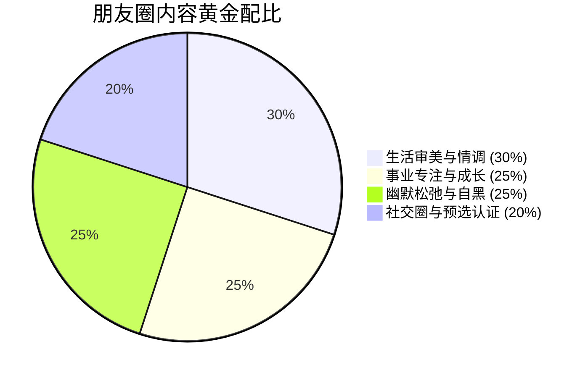

# 展示面与朋友圈降维操盘手册 (Social Media & Moments Masterclass)

> **“在微信生态里，你的朋友圈就是你的个人生活宣传片。女人不会爱上一个贫瘠乏味的灵魂，但会沉迷于一个丰盛而有趣的世界。”**

---

## 一、 门面三件套：3 秒决胜第一印象

```text
┌────────────────────────────────────────────────────────┐
│ 1. 微信头像：清晰、高质感、展现面部轮廓/生活状态，杜绝非主流网图/宠物当头像 │
│ 2. 朋友圈背景墙：展现生活格调或宽阔视野（如自驾雪山、艺术展、城市天际线） │
│ 3. 个性签名：简短、松弛、不装深沉、拒绝非主流伤感情歌台词             │
└────────────────────────────────────────────────────────┘
```

### 1. 头像避坑指南
- ❌ **绝对扣分项**：
  - 纯黑头像 / 伤感网抑云风（传递抑郁、负能量标签）；
  - 豪车方向盘摆拍 / 大金表特写（暴发户土气、低端租车摆拍感）；
  - 变形美颜过度甚至磨皮到五官模糊；
  - 随手自拍大头照、光线昏暗、直男死亡仰角。
- ✅ **顶级加分项**：
  - 阳光自然抓拍、半身侧脸、专注工作的瞬间；
  - 户外运动（滑雪、冲浪、露营、网球）、旅行胶片风，构图干净高级。

---

## 二、 朋友圈高价值建设的「黄金比例模型」

一周朋友圈发布频率建议：**2 - 3 条为宜**（宁缺毋滥，留足神秘感与留白空间）。



### 1. 审美与情调（30%）
- **核心**：展现你是一个有生活情趣、懂得享受生活的男人。
- **题材**：自己手冲咖啡的拉花、探店藏在老巷子里的无名威士忌吧、自己做的精致牛排、周末的书店或音乐现场。
- **文案公式**：**极简 + 情绪留白**。
  - 示例：“这家店的黑松露烩饭，值得原谅周一的所有糟糕。”

### 2. 事业专注与进取（25%）
- **核心**：展示雄性社会生存能力与向上野心，但**绝不高调炫耀财富**。
- **题材**：深夜办公室的窗景配合一杯咖啡、出差飞机舷窗下的云海、团队攻克难关后的庆祝干杯。
- **文案公式**：**轻描淡写，举重若轻**。
  - 示例：“终于搞定，今晚的晚风很给面子。”

### 3. 幽默松弛与生活自黑（25%）
- **核心**：打破高高在上的距离感，展现痞帅与大男孩的真实可爱面。
- **题材**：撸猫被猫嫌弃的表情包、学做烘焙结果烤糊了的黑色面包、朋友偷拍的搞怪抓拍。
- **文案公式**：**自嘲就是最高级的自信**。
  - 示例：“虽然厨艺翻车了，但好歹厨房还健在，值得庆贺。”

### 4. 社交圈与异性预选认证（20%）
- **核心（进化心理学最强催化剂：Preselection）**：
  - 当一个男人被其他高质量异性认可、簇拥时，他在目标女性眼中的性价值会瞬间暴涨。
- **实操红线**：
  - 严禁故意搂抱异性合影（容易被定性为恶俗海王）；
  - 正确操作：聚餐桌上不经意露出对面精致女性的美甲手部持杯、多人大合影中站在中心位置、女性朋友送的有趣小礼物的搞怪感谢。

---

## 三、 朋友圈互动神级心法：如何把“点赞”变成“私聊”

### 1. 绝对禁忌
- ❌ **秒赞怪与逢发必舔**：对方只要一发动态，1 秒内点赞并评论“太美了小仙女！”（直接被归入后宫备胎大军）。
- ❌ **长篇大论直男科普**：在人家晒照下面分析相机参数或纠正语法错误。

### 2. 勾魂评论法则：留钩子，引流私聊
- **场景 1：女生发美食打卡照片**
  - 直男评论：“看着好好吃啊，在哪里？”（无聊）
  - 祖师爷神评：“这家老板上个月欠我一顿饭，报我名字……应该也不会给你打折。”
  - 女生反应：必定在评论区笑怼或者直接发私聊问你：“哈哈哈哈真的假的？”
- **场景 2：女生发九宫格自拍**
  - 直男评论：“这也太漂亮了吧！”（廉价赞美）
  - 祖师爷神评：“第三张眼神有点凶，今天哪个倒霉蛋惹你了？”
  - 女生反应：瞬间产生倾诉欲，私聊：“被你看出来了，今天工作快气死我了……”

---

## 四、 断联期/冷淡期的“起死回生”朋友圈公式

如果你和目标女生已经断联了 1-2 周，甚至几个月没有聊天：
1. **不要直接发“在吗”**；
2. **精心策划一条与她有深度记忆锚点的朋友圈**（比如她曾经安利给你的小众电影、她老家的特色小吃、你们曾经聊过的一个小众梗）；
3. **配图与文案**：
   - 图片：该电影海报或打卡照。
   - 文案：“果然名不虚传，后劲有点大。”
4. **心理触发**：
   - 看到这条动态，她潜意识会瞬间联想到你和她的那段对话（认知共振）。
   - 只要她点赞或评论，**破冰窗口瞬间重新打开**，顺势私聊：“你当初安利的时候怎么没告诉我这么虐？”
