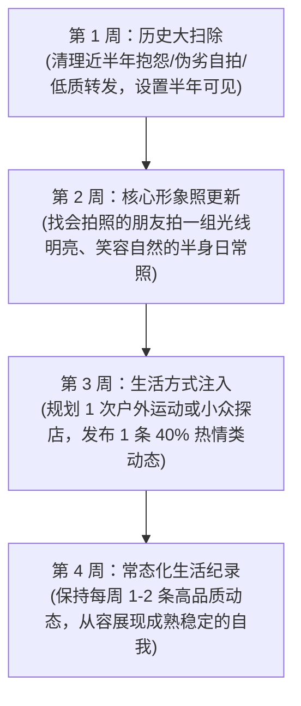

# 个人展示面与朋友圈生活构建 (Social Profile & Moments Architecture)

> **“朋友圈不是用来炫耀你拥有什么，而是真实映照你的生活状态与人格特质。最高级的吸引力是‘Show, Don't Tell’（展现，而非吹嘘）。一个本身就把日子过得丰满有趣的男人，从不需要刻意装腔作势。”**

---

## 一、 朋友圈内容的黄金配比 (The 4-3-2-1 Lifestyle Model)

根据 Mark Manson《Models》的核心吸引力法则，非语言与生活方式信号占据了吸引力的 80%。朋友圈是你的个人生活纪录片：

```text
┌────────────────────────────────────────────────────────┐
│ 朋友圈内容健康黄金比例 (The Golden Distribution)       │
├────────────────────────────────────────────────────────┤
│ 40% 【生命力与热情 (Vitality)】：户外、运动、旅行、探索未知 │
│ 30% 【审美与生活情趣 (Taste)】：美食烹饪、艺术、阅读、宠物 │
│ 20% 【幽默自嘲与日常留白 (Humor)】：生活中的乌龙段子、松弛感 │
│ 10% 【专注与专业认同 (Mastery)】：工作高光、深度思考、成就   │
└────────────────────────────────────────────────────────┘
```

---

## 二、 朋友圈高低价值对比与避坑红线

### 1. 绝对禁发的低价值“雷区”清单

| 禁发类型 | 典型翻车表现 | 暴露的致命心理缺陷 |
| :--- | :--- | :--- |
| **深夜伤痛抑郁小作文** | 凌晨 2 点单曲循环民谣，配文：“有些错过，注定是一辈子。” | 极度匮乏、情绪不稳定、依赖外界拯救的脆弱巨婴。 |
| **刻意摆拍豪车方向盘** | 照片核心焦点是名表或车标，人脸截掉一半。 | 虚荣心爆棚、渴望用物质装点自卑内核的“伪高价值”。 |
| **怨妇式职场/生活吐槽** | “恶心的人和事天天有，真是服了某些领导。” | 缺乏解决问题能力的负能量发射站，社交毒瘤。 |
| **疯狂连发刷屏 (刷屏狂)** | 一天发 6 条朋友圈，涵盖吃早饭、喝水、坐地铁。 | 现实生活极度无聊、注意力过度饥渴。 |
| **油腻爹味大道理说教** | 转发现实批判鸡汤，配文：“年轻人还是太浮躁，懂得自然懂。” | 好为人师、封闭自大的社交绝缘体。 |

### 2. 高价值朋友圈的真实呈现范式

- **场景 1：周末厨艺**
  - **画面**：一张刚出锅的煎牛排，旁边有散落的海盐与百里香，背景略微虚化。
  - ❌ **油腻文案**：“谁娶到我真是享福了，快来尝尝本大厨的手艺。”
  - ✅ **高质松弛文案**：“火候稍微大了一点，但黑胡椒挽救了整盘肉。今晚给厨房交差。”
- **场景 2：户外徒步/运动**
  - **画面**：山顶眺望远方的背影照，光线为落日余晖，抓拍自然。
  - ❌ **装逼文案**：“征服群山，我就是自己的王者。”
  - ✅ **真实趣味文案**：“爬到最后两公里腿都在抖，但看到这片晚霞，觉得膝盖还能再战。”
- **场景 3：宠物与生活细节**
  - **画面**：家里的猫霸占了笔记本键盘，一脸傲慢。
  - ✅ **极简文案**：“工位被非法占领，今日摸鱼理由充分。”

---

## 三、 文案写作心法：反向留白与幽默降调 (Understatement & Humor)

高级文案的核心秘诀是**“画面有力量，文字做降调”**：
1. **绝不把话说满**：照片已经展示了美丽的风景或高级的环境，文字就不要再用“太奢华了、太美妙了”等浮夸词汇，只需客观描述一个微小细节或幽默自嘲。
2. **文字在 15-30 字内收拢**：多留白，给看朋友圈的人留下主动评论和发问的“社交钩子”。
3. **互动回复原则**：统一在评论区回复大家的共同问题，对心仪对象的评论单独进行幽默接梗，但绝不在公共评论区公开调情。

---

## 四、 4 周展示面改造执行路线图 (4-Week Refresh Plan)


