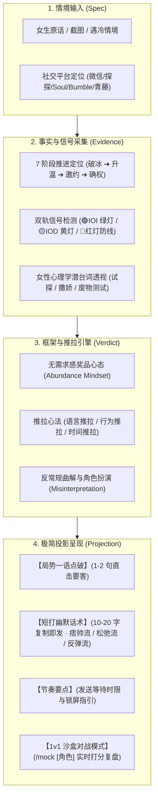
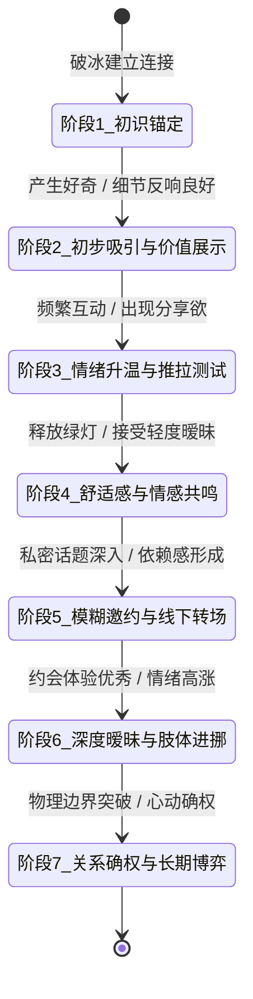

<div align="center">

# 💘 情感推拉智能体 · Push-Pull AI

**面向现代两性博弈与聊天破局的情感工程副驾 —— 意图透视、情绪推拉、超短幽默短打、1v1 沙盒对抗闭环**

[](package.json)
[](.agents/skills/emotional-master)
[](open_source_reference/qingsheng-skill/evals/evals.json)
[](open_source_reference/qingsheng-skill/LICENSE)
[](.agents/skills/emotional-master/references/tong_classic_quotes.md)
[](.agents/skills/emotional-master/SKILL.md)
[](.agents/skills/emotional-master/references/crush_sandbox_simulator.md)

</div>

---

## 💻 项目简介

Emotional-Push-Pull 是一套专为现代两性社交与恋爱博弈打造的轻量化测试与实战智能体。它主要负责**聊天意图透视、7 阶段关系推进、情绪推拉掌控与 1v1 沙盒对抗演练**，不承载任何低俗 PUA 与油腻土味烂梗。

> 核心流程：输入对话/截图 ➔ 破译潜台词与信号 ➔ 框架重构与推拉 ➔ 输出超短幽默短打

> [!IMPORTANT]
> **全系统唯一执行军规**：
> 核心话术严格遵循**“短平快（10~20字）、高级幽默、绝不油腻反蠢”**。任何输出均以真人微信随手发送的真实短句为唯一标准，不搞学术论文小作文与老土土味情话。

---

## 🏛️ 系统架构

整体执行流程：**情境输入 (Spec) ➔ 信号透视 (Evidence) ➔ 框架推拉 (Verdict) ➔ 短打输出 (Projection)** ：



---

## 🏗️ 四级架构分层规范 (4-Tier Component Boundaries)

系统资产划分为四大清晰层级，层次分明，模块自洽：

| 层级 (Tier) | 代表性组件 | 职责与生命周期 | 隔离与合规规则 |
|---|---|---|---|
| **Tier 1: 生产调用链核心** | `SKILL.md`<br>`push_pull_framing.md`<br>`female_psychology.md` | 承载实时聊天的最小闭环核心；控制全局 5 维短打流与军规校验。 | 零冗余依赖，指令严格受控于“短平快、高级幽默、绝不油腻”军规。 |
| **Tier 2: 专项实战武器库** | `seven_stages_engine.md`<br>`signals_and_kino.md`<br>`platform_playbooks.md`<br>`shit_tests_bible.md`<br>`recovery_and_cold_start.md` | 扩展性战术模块；覆盖 7 阶段推进、IOI/IOD 信号雷达、7 平台战法与送命题破解。 | 遵循按需加载原则，动态解耦，不污染默认对话上下文。 |
| **Tier 3: 沉浸式沙盒演练层** | `crush_sandbox_simulator.md`<br>`persona.md`<br>`coach.md`<br>`scene_preset.md` | 1v1 沙盒对战；支持 `/mock` 启动 5 种典型人设对抗并实时打分复盘。 | 角色扮演视窗与后台裁判席完全解耦，支持 `/exit` 随时退出。 |
| **Tier 4: 开源语料与基准测评层** | `qingsheng-skill/` (MIT)<br>`evals/evals.json`<br>`real_world_dialogue_examples.md` | 吸收开源巅峰成果，提供 40+ 真实分阶段语料与 22 套金标准测评集。 | 严格保留原作者 MIT License 与版权署名，100% 依法合规开源。 |

---

## 🔄 核心数据流与 7 阶段状态机 (State Machine)

每次对话根据以下状态机严格判定，杜绝节奏错乱（严防在该调情时查户口，在该表白时讲道理）：



---

## 🎛️ 四大核心动作闭环

```powershell
# 1. 聊天解围（日常默认）
"女生问我：'你平时是不是经常这么骗女生？' 怎么回"

# 2. 启动 1v1 沙盒模拟对战
/mock 傲娇高冷御姐
/mock 慢热敏感文艺女
/mock 现实职场大女主
/mock 段位极高的绿茶海后

# 3. 退出演练模式
/exit

# 4. 运行基准自动化评测集（22 个实战案例）
cd open_source_reference/qingsheng-skill/evals && bash run_evals.sh
```

- **`diagnose()`**：7 阶段定位、IOI/IOD 信号检测与潜台词深度破译。
- **`steer()`**：气泡植入、无缝话题嫁接、悬念留白与升维直击灵魂。
- **`strike()`**：输出 3 套极简幽默短打方案（10-20 字，复制即发）。
- **`mock()`**：AI 扮演目标角色实时过招，每轮给出好感度加减分与祖师爷复盘。

---

## 🛠️ 代码与知识库目录说明

```text
emotional-push-pull/
├── .agents/skills/emotional-master/          # 核心增强版专属 Skill 资产
│   ├── SKILL.md                              # 主控中枢（5维短打流 + 核心军规）
│   └── references/                           # 17 个专业模块手册
│       ├── seven_stages_engine.md            # 7 阶段关系推进全景引擎
│       ├── signals_and_kino.md               # IOI/IOD 信号雷达与 4 阶 Kino
│       ├── mindset_meta_concepts.md          # 15 大两性吸引力元心法库
│       ├── platform_playbooks.md             # 7 大社交平台差异化指南
│       ├── advanced_conversation_steering.md # 高维话题主导五大心法
│       ├── recovery_and_cold_start.md        # 冷场起死回生与断联破冰
│       ├── crush_sandbox_simulator.md        # 沙盒实战演练手册 (/mock)
│       ├── real_world_dialogue_examples.md   # 40+ 真实分阶段语料案例库
│       ├── profile_audit_rules.md            # 展示面诊断打分标准
│       ├── tong_classic_quotes.md            # 童锦程名场面与骚话库
│       ├── shit_tests_bible.md               # 废物测试通关圣经
│       ├── push_pull_framing.md              # 推拉心法与框架掌控
│       ├── female_psychology.md              # 女性心理学与潜台词解码
│       └── chat_playbook.md                  # 实战聊天与约会推进手册
├── open_source_reference/                    # 完整开源原版归档（100%合规）
│   ├── qingsheng-skill/                      # 情圣原版全套资产 (MIT License)
│   │   ├── LICENSE                           # 原版 MIT 开源授权协议
│   │   ├── README.md                         # 原版使用文档
│   │   └── evals/evals.json                  # 22 个真实实战黄金评测数据集
│   └── relationship-training-skill/          # Crush 沙盒模拟训练营原版全套资产
├── .gitignore                                # 过滤系统临时文件与缓存
└── README.md                                 # 本项目全景系统说明书
```

---

## 🛡️ 核心合规与安全门禁

| 安全层级 / 维度 | 审查机制 | 目标与底线 |
|---|---|---|
| **1. 开源协议合规** | 完整保留 MIT License | 遵循开源规范，合法收录与二次研发，绝不侵权 |
| **2. 知情同意原则** | 1 秒后撤与安全阶梯 | 任何接触必须建立在女方自愿基础上，遭遇拒绝立即停止 |
| **3. 零恶意欺诈** | 严禁经济纠葛与欺诈 | 聚焦社交情商与推拉，坚决抵制任何借贷与人身侵害 |
| **4. 严防油腻低俗** | 纯净输出过滤词库 | 严禁恶俗土味情话与黄色废话，保持松弛从容 |
| **5. 真实生活原则** | 拒绝虚假伪装 | 推拉是破冰工具，倡导基于个人真实生活的自我提升 |

---

## 🧪 评测矩阵与实战基准 (Evals)

项目内置 22 个实战基准测试用例，位于 [`open_source_reference/qingsheng-skill/evals/evals.json`](open_source_reference/qingsheng-skill/evals/evals.json)，覆盖五大核心验证域：

| 验证域 | 代表用例 | 核心考核标准 |
|---|---|---|
| **冷淡救急** | `chat-coldness-scenario` | 回复变慢 IOD 诊断、冷冻期计算、禁止连续追问 |
| **邀约受挫** | `date-rejection-analysis` | 藉故加班借口透视、朋友圈行为矛盾、投入比计算 |
| **送命题破解**| `shit-test-response` | 废物测试识别、严禁自证、分级幽默化解话术 |
| **多目标切换**| `multi-target-switch` | 独立目标上下文隔离、平台来源区分、分流不混淆 |
| **情绪主导** | `emotional-leading-scenario` | 摆脱应答机模式、反常规曲解、掌握对话框架 |

---

## 📚 深度文档中心

- 📐 [**主控执行军规**](.agents/skills/emotional-master/SKILL.md) — 5 维短打流与超短极简准则
- 🧠 [**女性心理学解码**](.agents/skills/emotional-master/references/female_psychology.md) — 语言双轨制与潜台词大辞典
- 🔄 [**7 阶段推进全景引擎**](.agents/skills/emotional-master/references/seven_stages_engine.md) — 从初识到确权全流程状态机
- 🎮 [**沙盒模拟对战手册**](.agents/skills/emotional-master/references/crush_sandbox_simulator.md) — 1v1 沉浸式对练与实时打分机制
- 💬 [**40+ 真实分阶段语料库**](.agents/skills/emotional-master/references/real_world_dialogue_examples.md) — 真实对话场景精析与避坑指南
- ⚡ [**童锦程名场面金句库**](.agents/skills/emotional-master/references/tong_classic_quotes.md) — 祖师爷经典骚话与高境界自律心法
