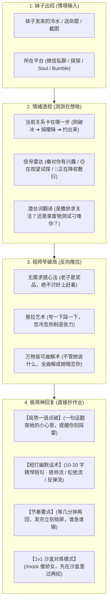
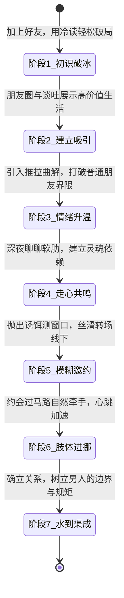

<div align="center">

# 💘 情感推拉智能体 · Push-Pull AI

**别在聊天软件里当小丑了 —— 专治已读不回、送命题刁难与无效内耗，你的祖师爷级极简高情商嘴替**

[](package.json)
[](.agents/skills/emotional-master)
[](open_source_reference/qingsheng-skill/evals/evals.json)
[](open_source_reference/qingsheng-skill/LICENSE)
[](.agents/skills/emotional-master/references/tong_classic_quotes.md)
[](.agents/skills/emotional-master/SKILL.md)
[](.agents/skills/emotional-master/references/crush_sandbox_simulator.md)

</div>

---

## 💻 项目简介

兄弟，谈恋爱不是去考公，聊天更不是去派出所录笔录。为什么你天天打卡“早安晚安吃了没”只能换来“呵呵我去洗澡了”，别人谈笑风生几句话就能让妹子整晚抱着手机笑？差的从来不是钱，而是**情绪过山车**和**骨子里的松弛感**。

这个项目就是你的专属高阶恋爱嘴替 —— 彻底告别查户口与舔狗式自证，用最懂女性心理学的推拉心法，把聊天的节奏和主动权重新拿回自己手里。

> 核心心法：妹子发招 ➔ 一秒看穿小心思 ➔ 反客为主打破框架 ➔ 甩出一句短小骚气神回复（零油腻 · 零舔狗 · 复制即发）

> [!IMPORTANT]
> **祖师爷死命令：短一点！幽默点！不要太蠢！**  
> 坚决封杀一切“捕捉野生小可爱”、“小仙女”等十几年前的恶俗油腻烂梗，也不许写八百字长篇大论。  
> 话术严格限制在 **10~20 字以内**，说人话，像真人随手发的一条微信短句，云淡风轻间把妹子撩得心跳加速。

---

## 🏛️ 实战对决流水线

整体实操节奏：**妹子出招 (截屏/原话) ➔ 情绪透视 (测测在想啥) ➔ 祖师爷破局 (反向推拉) ➔ 极简神回复 (抄作业)** ：



---

## 🏗️ 弹药库四大分层

项目里的武器分门别类，层次分明，随用随取：

| 层级 | 代表模块 | 负责干啥 | 规矩与准则 |
|---|---|---|---|
| **第一层：核心大脑** | `SKILL.md`<br>`push_pull_framing.md`<br>`female_psychology.md` | 主脑调度；底层推拉哲学与女性潜意识解码。 | 纯正童锦程松弛感，死守“短平快、带点坏、绝不油腻”的铁律。 |
| **第二层：实战军火库** | `seven_stages_engine.md`<br>`signals_and_kino.md`<br>`platform_playbooks.md`<br>`shit_tests_bible.md`<br>`recovery_and_cold_start.md` | 专项战术兵器；7 阶段推进、IOI/IOD 信号雷达、7 大社交软件玩法、20+ 送命题破解。 | 聊天卡壳、遇到刁难或被冷落时，直接调用对应的解法手册。 |
| **第三层：实战靶场** | `crush_sandbox_simulator.md`<br>`persona.md`<br>`coach.md`<br>`scene_preset.md` | 1v1 沉浸式对战沙盒；输入 `/mock` 让 AI 扮演傲娇学姐跟你对线。 | 真实还原妹子的傲娇与挑刺，每轮当场打分复盘，免得你在真人面前交学费。 |
| **第四层：原版经典语料** | `qingsheng-skill/` (MIT)<br>`evals/evals.json`<br>`real_world_dialogue_examples.md` | 吸收业内顶尖开源精华；40+ 真实分阶段翻车与翻盘案例，22 套大考题。 | 完整保留原版开源协议与版权，依法合规，真实案例经得起推敲。 |

---

## 🔄 搞清你在第几步 (7 阶段防翻车状态机)

别在刚认识时查户口，别在暧昧期讲大道理，看清当前走到了哪一步：



---

## 🎛️ 四大常用操作

平时不用死记硬背，这四招直接拿来用：

```powershell
# 1. 遇到卡壳直接甩原话（日常解围）
"妹子发：'你平时是不是经常这么骗小姑娘？' 帮我回一下"

# 2. 找个 AI 妹子陪练过招（沙盒对练）
/mock 傲娇高冷学姐
/mock 慢热文艺女
/mock 职场大女主
/mock 段位极高的绿茶海后

# 3. 练完了随时撤退
/exit

# 4. 跑跑 22 道真实实战考题
cd open_source_reference/qingsheng-skill/evals && bash run_evals.sh
```

- **`排雷诊断`**：一眼看出她这句话是在撒娇、在考验你、还是在养鱼备胎。
- **`顺滑带节奏`**：绝不尬聊，用气泡留钩子、无缝转移话题，把死天聊活。
- **`极简短打`**：直接给 3 句短小精悍的骚话方案，复制就能发。
- **`沙盒挨打练招`**：在真实战场丢脸前，先在模拟器里跟傲娇 AI 练出肌肉记忆。

---

## 🛠️ 本地弹药库全景目录

```text
emotional-push-pull/
├── .agents/skills/emotional-master/          # 你的专属主力武器库
│   ├── SKILL.md                              # 总控总纲（极简短打 + 绝对军规）
│   └── references/                           # 17 个专项绝杀手册
│       ├── seven_stages_engine.md            # 7 阶段全景推进手册
│       ├── signals_and_kino.md               # 测好感雷达与约会牵手 4 级阶梯
│       ├── mindset_meta_concepts.md          # 奖品心态与猫绳理论等 15 大心法
│       ├── platform_playbooks.md             # 微信/探探/Soul/Bumble 差异化指南
│       ├── advanced_conversation_steering.md # 怎样聊天不冷场的高维心法
│       ├── recovery_and_cold_start.md        # 被冷落、断联与分手的起死回生术
│       ├── crush_sandbox_simulator.md        # 1v1 沙盒对战手册 (/mock)
│       ├── real_world_dialogue_examples.md   # 40+ 真实分阶段对话案例
│       ├── profile_audit_rules.md            # 朋友圈与头像诊断标准
│       ├── tong_classic_quotes.md            # 祖师爷童锦程经典语录骚话库
│       ├── shit_tests_bible.md               # 20+ 经典送命题通关圣经
│       ├── push_pull_framing.md              # 推拉心法与掌控谈话框架
│       ├── female_psychology.md              # 女性心理学与潜台词大白话字典
│       └── chat_playbook.md                  # 场景开场白与连环约会转场设计
├── open_source_reference/                    # 完整开源原版归档（100%合规，原汁原味）
│   ├── qingsheng-skill/                      # 情圣开源全套资料 (MIT License)
│   │   ├── LICENSE                           # 官方 MIT 开源协议
│   │   └── evals/evals.json                  # 22 个真实实战黄金考题集
│   └── relationship-training-skill/          # Crush 模拟训练营原版源码
├── .gitignore                                # 忽略垃圾文件
└── README.md                                 # 本指南
```

---

## 🛡️ 祖师爷的爷们底线

可以痞帅，可以玩推拉，但坚决不当人渣：

| 规矩 | 底线要求 |
|---|---|
| **1. 绝不白嫖侵害** | 任何身体接触必须建立在妹子心甘情愿的前提下；敢有半点迟疑和抗拒，1 秒内绅士退回，绝不硬上。 |
| **2. 绝不搞经济诈骗** | 聊的是情商与吸引力，坚决反对任何形式的借贷、骗钱和伤害他人的行为。 |
| **3. 拒绝油腻恶俗** | 嘴上带点坏是幽默，开黄腔是性骚扰；分寸感才是高级玩家的分水岭。 |
| **4. 做好自己才是王道** | 推拉是破冰的催化剂，但真正长久的吸引力源于你自己的事业、审美、身材和生活。搞定自己，你就是奖品。 |

---

## 🧪 22 套真实实战考卷 (Evals)

仓库收录了 22 个真实场景考题（见 [`open_source_reference/qingsheng-skill/evals/evals.json`](open_source_reference/qingsheng-skill/evals/evals.json)），随时拉出来检验实力：

| 考题类型 | 典型场景 | 考核标准 |
|---|---|---|
| **突然变冷** | 昨天聊得好好的，今天突然几个小时回一句 | 识别降权信号、立刻战术冷却、禁止连环夺命追问 |
| **约不出来** | “这周末要加班诶，下次吧” | 识破借口、分析朋友圈反差、优雅后撤不给压力 |
| **送命考验** | “你平时是不是对每个女孩都这样？” | 严禁老实巴交自证，幽默曲解反客为主 |
| **多线作战** | 一个同事、一个软件刚匹配的妹子同时聊 | 独立人设记忆隔离，不同平台不同打法 |
| **反客为主** | 妹子想掌握主动权，爱搭不理 | 打破她的高傲预期，用推拉重构高价值框架 |

---

## 📚 常用秘籍直达

- 🎯 [**总控执行铁律**](.agents/skills/emotional-master/SKILL.md) — 超短、幽默、不蠢的最高标准
- 💡 [**女性心理学大白话字典**](.agents/skills/emotional-master/references/female_psychology.md) — 听懂“我没事”、“看心情”到底什么意思
- 📈 [**7 阶段关系推进全景手册**](.agents/skills/emotional-master/references/seven_stages_engine.md) — 走好每一步，别瞎表白
- 🥊 [**1v1 对战沙盒手册**](.agents/skills/emotional-master/references/crush_sandbox_simulator.md) — `/mock` 随时随地找 AI 妹子练招
- 🗣️ [**40+ 真实对话案例库**](.agents/skills/emotional-master/references/real_world_dialogue_examples.md) — 看看高手是怎么把死天聊活的
- 🔥 [**童锦程经典语录库**](.agents/skills/emotional-master/references/tong_classic_quotes.md) — 祖师爷名场面骚话，随时拿来用
