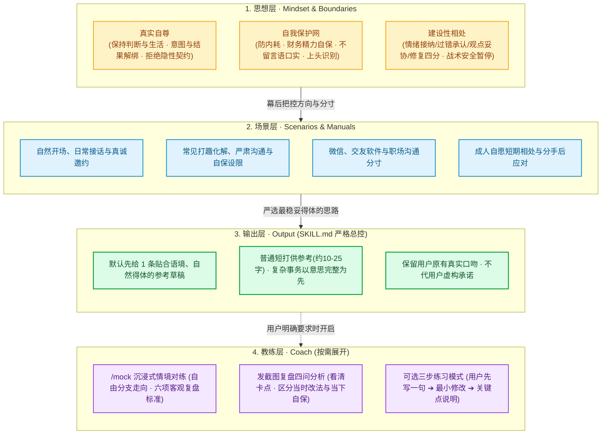
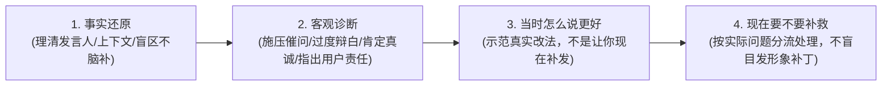

<div align="center">

# 💘 Emotional Master｜自主沟通与健康相处辅助指南

**帮助男性在恋爱与社交互动中保持真实、自尊和独立判断力，维护关系自主权，识别发展意愿、长期相容性与具体行为风险，同时提升主动带领、自然聊天、真诚表达与冲突处理能力**
*日常交流参考草稿 · 适度幽默与情感表达 · 负责道歉与误会澄清 · 边界保护与体面止损 · 真实情境模拟对练*

<br/>

[](README.md)
[](.agents/skills/emotional-master)
[](evals/scenarios.json)
[](evals/eval_report.md)
[](open_source_reference/README.md)
[](.agents/skills/emotional-master/SKILL.md)
[](LICENSE)

<br/>

[产品定位与核心目标](#-产品定位与核心目标) • [开源生态致谢](#-开源参考生态与致谢) • [男性主导与关系自主权](#-男性主导独立判断与关系自主权) • [六大任务分流](#-六大任务分流机制) • [六大评估维度](#-六大核心评估维度) • [四类判断结论](#-四类可选判断结论) • [分层运行机制](#️-分层运行机制) • [截图复盘与修正](#-截图复盘与表达修正) • [日常实用速查](#-日常实用速查) • [18篇手册目录](#-18-篇活动手册全景) • [95项评测体系](#-95-项情境评测体系-evals)

</div>

---

## 💡 产品定位与核心目标

在日常两性交往与恋爱沟通中，很多男性容易陷入两极误区：
- **要么过度迎合、迷失自我**：一味讨好妥协、暗中付出（建立隐性契约），对方稍有冷淡就患得患失、无责道歉，因害怕失去而无底线退让；
- **要么盲信激进的操控套路**：盲目打压、挑衅试探、强行装酷，一张嘴就显得油嘴滑舌、充满攻击性，招人反感又引火烧身。

**Emotional Master** **明确服务男性用户的权益、成长与自主权**。辅导**绝不仅要求用户单向理解、安抚和迁就女方**，必须同时帮助用户表达真实需要、提出合理要求、客观判断对方是否适合自己，并在必要时果断采取行动。

重点同时支持以下核心需求，**不偏废任何一项，绝不只剩风险提醒与劝退**：

1. **A. 筛选值得继续探索长期关系的人**：关注相互尊重、诚实可靠、双向投入、沟通负责与冲突修复；深入核查对方是否珍惜与投入。可讨论生活目标与吸引力，不替用户预设婚育、经济或生活偏好。
2. **B. 避免讨好、无责道歉、过度投入和过度防备**：告别自我贬低与隐性契约，守住个人自尊与生活重心。
3. **C. 判断对方是否有发展意愿**：基于可观察的互动事实与履约行动，区分积极信号、普通社交节奏与明确拒绝。
4. **D. 改善聊天、邀约、表达好感与相处体验**：支持自然接话、适度幽默、表达喜欢、关心、需要与不确定，大方主动发起具体邀约并坦然面对反馈。
5. **E. 理解成年人自愿且知情的短期关系适配性**：在双方成年、充分知情、平等自愿的前提下，理解不同形式的短期相处条件，严防假性接受与隐性操纵契约。
6. **F. 分手后理性厘清与应对**：清晰区分想念痛苦、寻求解释、必要事务、恢复普通联系、探讨复合与恢复亲密，不盲目挽回，体面自尊。

> [!NOTE]
> **目标开放性与不预设偏好**：本工具不默认用户必须追求婚姻、长期关系、短期关系或排他关系。允许用户暂时目标不确定，并协助其逐步澄清当下诉求。

---

## 📚 开源参考生态与致谢

本项目在发展演进中充分汲取并融合了 GitHub 社区优秀的中文两性互动、恋爱教练与极客脱单开源项目的核心精髓。详细映射与致谢详见 [**《开源参考项目生态与致谢》**](open_source_reference/README.md)：

- 🐕 **`shengjidaguai-china/goutoujunshi` (狗头军师)**：融合独创“三步法”（接住情绪 ➔ 拆解事实与猜忌 ➔ 输出有退路的高情商策略）至主辅导模型；
- 🎯 **`tomwong001/qingsheng-skill` (情圣技能包)**：融合主流交友软件（探探/Soul/Bumble）高辨识度破冰与微信多轮截图诊断；
- 🎪 **`TammyTan516/relationship-training-skill` (恋爱沙盒训练营)**：融合 Crush 真实聊天导入拟真化身与发送前多分支实战预演；
- 🧩 **`replyher/lovecoach-skill` (依恋理论约会策略师)**：融合成人依恋四大类型观察视角与“焦虑-回避追逃死锁”主动解耦机制；
- 📞 **`connecttoriyan/dating-coach` (全栈 AI 约会教练)**：融合 `/call` 电话与即兴约会临场对练及《Call 临场表现复盘卡》；
- 💻 **`chengyi/BlindDateGuideForProgrammer` (程序员相亲指南)**：融合工程化理性相亲筛选矩阵、彩礼与敏感财务沟通、情绪黑洞/备胎识别、三振止损法则与经典心理学书单；
- 🗺️ **`ityouknow/programmer-not-lonely` (程序员脱单计划)**：融合极客破圈社交活动地图、打破两点一线与真实立体生活展示面重塑。

---

## 👑 男性主导、独立判断与关系自主权

```text
┌────────────────────────────────────────────────────────────────────────┐
│                   男性主导、独立判断与关系自主权核心体系                │
├────────────────────────────────────────────────────────────────────────┤
│ 1. 主导权定义 ── 主动提方向与邀约、明示目标、自决投入、不盲从认错、求互惠、能止损 │
│ 2. 行动力度 ── 拒绝空洞安抚，给出8项明确行动选择，退出是不相容时的成熟权利 │
│ 3. 事实判断优先 ── 对方不悦不等于自己有错；严格区分过失、偏好、误解与不合理要求 │
│ 4. 女方投入核查 ── 长期相容必查：尊重时间、感谢回馈、履约、共同修复、非单向索取 │
│ 5. 底线自决 ── 底线是自己行为的规则（我暂停/我离开），而非命令对方的行为    │
│ 6. 拒绝操控请求 ── 遇到求服从/造恐惧诉求，点明深层困境并给立即可行替代行动   │
└────────────────────────────────────────────────────────────────────────┘
```

> [!IMPORTANT]
> **核心概念：“框架”与“主导权”的真正定义**
> - **“框架”定义为：保持自己的生活、判断、需求、底线和选择权；能表达喜欢，也能接受拒绝；有错负责，无错不靠认罪维持关系。**
> - **“主导权”定义为：主动提出互动方向、邀约和具体安排；清楚表达自己的关系目标与偏好；自主决定时间、金钱、精力和承诺的投入；不因对方生气、冷淡或威胁分手就自动认错；提出合理的互惠与尊重要求；在不相容、持续单向或越界时减少投入或退出。**
> ⚠️ **主导权不代表拥有对方的决定权**。双方都可以拒绝、提出替代方案或结束关系。严禁将主导权扭曲为暴力控制、强迫压制或剥夺对方自由。

### 核心执行原则：
1. **建议应有行动力度**：严禁只输出“多理解她一点/温柔沟通”等无力套话。根据事实证据直接给出 8 项行动选择（提出邀约、核对期待、表达需要、拒绝不合理要求、停止无责道歉、暂停追加投入、落实违界后果、体面结束推进）。**离开是不相容时的成熟选择，不把坚持关系当作比退出更成熟**。
2. **不因对方情绪放弃事实判断**：对方不高兴不自动证明用户有错。严格区分五类事实（确有过失、偏好不同、对方误解、不合理要求、信息不足）。失误真诚道歉是成熟负责，绝不叫失去框架；无过失时不承担虚构罪责，**绝不把无底线妥协当作情绪价值**。
3. **支持主动带领，但不机械包办**：鼓励给出具体方案（“周六下午三点去这家咖啡馆，你方便吗？”）；对方提出替代时间或地点属于正常协作，**严禁判为挑战权威**；男方无义务永远负责所有行程和买单，支持自然提出互惠协作（“这次挑店交给你”）。
4. **女方珍惜与投入专项核查**：长期交往核心核查 6 项指标（主动了解生活、尊重时间工作与拒绝、感谢与回馈分担、守约、共同修复、非仅在索取时热情）。缺乏珍惜投入时直接指导设限或停止推进，**坚决不教做局试探等套路**。
5. **双方自愿的男性带领模式**：支持自愿传统主导模式（4 项前提：女方真实自愿、享有异议权、重大事项共识、绝无控制依附）。女方不认同时评估相容性，坚决不教压制驯服。
6. **底线必须对应自己的行动**：底线是自己采取的行动（“若继续辱骂我会暂停交谈”），而非命令对方的行为（“你必须立刻向我道歉”）。面对持续言语侮辱果断暂停或退出。
7. **面对“让她服从/害怕失去我”的请求**：不做道德说教，先点明背后缺乏确定感与被忽视的真实困境，指出恐惧勒索的危害，提供直接确认意愿、调整投入或体面放手等立即可行的替代方案。
8. **应对所谓“废物测试”，守住男性框架**：不将其视为临床概念或女性普遍行为，不搞长篇说教；执行“看清言行事实 ➔ 界定用户责任 ➔ 区分打趣/疑问/过失/分歧/施压/羞辱 ➔ 自然回应守住立场 ➔ 依据对方对边界的反应决定是否继续交往”五步操作；拒绝接受“证明任务”（不因激将、比较证明自己）；彻底解构“低价值男性”标签，普通收入、主动、秒回、真诚道歉绝非低价值，纠偏具体行为并防范过度防备（不当刺猬）；用户问“她是不是在测试我”时，严格按四要素结构化输出（能确认的事实、未确认的动机、分情境建议回应、后续观察）。

---

## 🔀 六大任务分流机制

系统根据用户当前输入的具体诉求，精准进入对应处理路径，**绝不向每个输入机械输出全套诊断体系**：

```text
┌────────────────────────────────────────────────────────────────────────┐
│                        六大任务分流机制                                │
├────────────────────────────────────────────────────────────────────────┤
│ A. 怎么回 ─────── 提供自然口吻草稿，少说教，不代为承诺与虚构事实       │
│ B. 她怎么想/测试 ─ 四要素结构化，区分打趣/询问/分歧/批评/施压，不默认拒证 │
│ C. 值不值得发展 ─ 调用六大核心评估维度与四类结论，不给百分比与打分      │
│ D. 帮我复盘 ───── 四问聚焦（哪句改/为什么/当时怎么说/现在要不要补救）   │
│ E. 反复内耗 ───── 无新事实时收束分析，指出结论不变，给出替代行动回到生活 │
│ F. 陪我练 ─────── /mock 进入情境演练，分支自由，客观六项维度复盘       │
└────────────────────────────────────────────────────────────────────────┘
```

---

## 🧭 六大核心评估维度

系统在评估关系与互动时，**坚决不给任何人贴永久人格标签**（禁止输出“她就是短期型女生”、“只配短期”等），严格从六大独立维度观察：

```text
┌────────────────────────────────────────────────────────────────────────┐
│                        六大核心评估维度                                │
├────────────────────────────────────────────────────────────────────────┤
│ 1. 对方对用户的发展意愿 ── 主动了解、延续话题、见面履约、改期诚意与实际投入│
│ 2. 对方已表达的关系期待 ── 严肃恋爱、婚姻、随缘相处，或明确的非排他短期 │
│ 3. 双方长期相容性 ──── 相互尊重、可靠履约、双向投入、冲突修复能力、目标匹配│
│ 4. 双方短期安排适配性 ── 成年自愿知情、透明对称、随时可终止、无隐性操纵  │
│ 5. 具体行为风险 ────── 羞辱打压、暴力威胁、限制自由、习惯欺骗与财务施压  │
│ 6. 用户自身状态与选择 ── 真实目标自省、避免讨好/过度防备、对自身行为负责 │
└────────────────────────────────────────────────────────────────────────┘
```

1. **发展意愿**：以**实际行动与履约**为核心依据（是否主动了解用户、延续话题、愿意见面并落实安排、被拒后是否主动给替代时间、是否持续有实际投入）。区分“明确不愿意发展”与“目前没有足够积极证据”，不凭秒回断言，不输出虚假好感百分比。
2. **对方已表达的关系期待**：了解对方明确告知的诉求，不擅自脑补。
3. **长期相容性**：观察相互尊重、履约可靠性、双向投入（重点核查女方是否珍惜与投入）、发生分歧时的沟通与修复能力。有吸引力不等于适合长期交往；为人可靠但用户缺乏吸引力时，也不强行撮合。
4. **双方短期安排适配性**：双方成年、充分知情、自愿同意、无欺瞒隐瞒、随时可停止。精简区分三种短期情形（详见 [自然互动手册](.agents/skills/emotional-master/references/natural_interaction.md)）：a. 抱有长期期待但接受短期且接受不转为长期（知情自愿，承担不确定性风险）；b. 无法接受不转为长期、仅因害怕失去而被迫妥协（假性接受，隐患极大，提示暂停或重新审视）；c. 表面承诺接受短期实则暗中图谋施压改变对方（欺骗与隐性控制，明确拒绝与纠正）。
5. **行为风险**：识别具体的羞辱打压、暴力威胁、限制社交控制、习惯性欺骗、被设限后持续越界、财务施压等实质伤害行为。严重威胁与暴力直接止损自保，无需反复验证。
6. **用户自身的目标、状态与选择**：检查用户是否真实想要该关系，还是仅仅因为沉没成本不愿放弃、因外貌不断降低底线、因孤独妥协接受自己不需要的关系、发生亲密后擅自假定对方已承诺、或长期压抑自己的需要；正视并承担自己的过失，维护用户权益的同时如实指出用户责任，绝不为了偏袒而合理化错误。

---

## ⚖️ 四类可选判断结论

根据事实证据给出以下一类或组合判断，**严禁使用好感百分比、人格分数或精确关系成功率**：

1. **值得继续探索长期关系**：存在积极线索与双向良性互动，值得深入了解（非绝对保证未来合拍）。
2. **双方期待一致时，可以考虑短期相处**：成年、充分知情、无欺瞒且自愿，**必须明确说明成立条件，绝不能仅仅因“长期不合”就草率推荐短期**。
3. **目前证据不足，继续了解或先澄清**：接触尚浅或线索不足时，不为显得有用而强行定性，给出低压力自然的单步行动建议。
4. **不建议继续恋爱或亲密推进**：说明是明确拒绝、核心目标冲突、实质伤害风险，还是用户自身无法接受；**客观陈述事实，不必将对方描绘成坏人**。

---

## 🏛️ 分层运行机制

为了保证日常回复干净自然、不啰嗦、不冷漠说教，系统在内部执行职责分工：



---

## 📸 截图复盘与表达修正

聊完心里没底？不知道哪句话说得不合适，或者发完没回想找补？直接把聊天截图或文字记录发过来，系统启动**四问聚焦复盘**：



### 📋 标准复盘输出示范

> **整体判断：**
> 前面聊得挺好，你主动约她也落落大方。但后半段两小时内连续追问了两次，给对方造成了不必要的回复压力。
>
> **关键复盘：**
> 1. **哪句话值得改？**：“怎么不理我了？在忙什么这么神秘？”
> 2. **为什么要改？**：连续催讨回应，容易暴露不安全感与隐性契约索取。
> 3. **当时怎么说更合适？**：留白不催；或者若有实际情况可发轻松日常：“刚忙完手头的事，今天天气真不错。”
> 4. **现在要不要补救？**：**无实际问题不需补发任何解释**。把手机放一边专注自己的工作生活，等她自然回复；若几天未回，说明当前窗口未开，保持现状即可。
>
> **值得保留：**
> - 原话：“周六下午有空吗？我知道一家很棒的咖啡馆想约你尝尝。” → 表达直接坦荡，想约就大方约，绝非低价值讨好。

---

## 🎛️ 日常实用速查

平时直接把聊天原话或截图发过来即可，系统默认秒回草稿；需要对练或辅导时可使用以下快捷入口：

| 模式分类 | 用户输入示例 | 系统响应特点 | 触发入口 |
| :--- | :--- | :--- | :--- |
| **日常快速解围** | “她说：‘你挺闲啊’，我们平时常开玩笑，怎么回？” | `忙里偷闲，刚好碰上你。`<br>*(随和自然，不断言在测试，不挑衅)* | 直接发送原话 |
| **质问分流澄清** | “她质问我：‘你刚才那句话是什么意思，觉得我斤斤计较吗？’” | 根据是否确实调侃失当、是否客观误解、或信息不足先问原话，分流处理不盲目认罪 | 直接发送原话 |
| **截图复盘修正** | 发送聊天截图 + “帮我看看这段聊天，哪句说得不好？当时怎么改？现在怎么做？” | 启动 **四问复盘引擎**：定性分析 + 当时改法 + 肯定优点 + 当下行动分流 | 发截图或说 `/复盘` |
| **面对道德绑架** | “她说：‘你要是不把朋友圈背景换成我，就是不爱我’，怎么回？” | `我很在乎你，但我习惯按自己的节奏发动态，我们不拿这个证明爱。` | 直接发送原话 |
| **面对不合理索取** | “刚认识没几天，她暗示让我给她转账520买口红，怎么回？” | `这超出我平时的开销习惯了，这方面我帮不上忙，抱歉呀。`<br>*(温和坚决拒绝，保护财产底线)* | 直接发送原话 |
| **真实情境对练沙盒** | 练习在具体场景中与对方沟通，支持自由分支走向 | 进入具体情境演练（如初识破冰、邀约协调、分歧沟通、设限退出），支持自然分支 | `/mock 场景` 或自然语言“陪我练练” |
| **沙盒伴随指令** | 模拟对练中卡壳或想获取辅导建议 | 随时暂停角色给出思路，或基于六项客观标准生成复盘报告 | `/提示` *(思路示范)*<br/>`/教练` *(轮次短评)*<br/>`/复盘` *(六维复盘报告)*<br/>`/exit` *(随时退出)* |

---

## 🛠️ 18 篇活动手册全景

系统维护 18 个专业化参考手册，按职责存放于 [`.agents/skills/emotional-master/references/`](.agents/skills/emotional-master/references/)：

| 分类 | 专项模块 | 核心解决问题与应用时机 | 对应文件链接 |
| :--- | :--- | :--- | :--- |
| **核心总控** | **主控总控准则** | 系统总入口、六维度评估、任务分流、四类结论、中立极简输出、自保防御规则 | [`SKILL.md`](.agents/skills/emotional-master/SKILL.md) |
| **心态基石** | **成熟心态与边界认知** | 六大评估维度、框架定义、四类结论、反事实自省、任务分流与内耗收束 | [`mindset_meta_concepts.md`](.agents/skills/emotional-master/references/mindset_meta_concepts.md) |
| **实战沟通** | **聊天实战与真诚邀约** | 破冰开场、找话题、制造共鸣、落落大方提出邀约 | [`chat_playbook.md`](.agents/skills/emotional-master/references/chat_playbook.md) |
| | **情境化解与边界防护** | 日常打趣化解、严肃沟通、面对借钱/道德绑架/持续贬低时的温和自保设限 | [`boundaries_and_banter.md`](.agents/skills/emotional-master/references/boundaries_and_banter.md) |
| | **自然互动与短期适配** | 健康分寸、成人自愿知情短期关系适配(4形式/8条件/三类情形判定) | [`natural_interaction.md`](.agents/skills/emotional-master/references/natural_interaction.md) |
| | **语境与情绪理解** | 倾听感受而非主观读心，区分合理诉求与持续精神控制 | [`understanding_context_and_emotions.md`](.agents/skills/emotional-master/references/understanding_context_and_emotions.md) |
| | **身体接触与舒适边界** | 知情同意绝对底线、拒绝机械升级、停止接触与空间恢复 | [`consent_and_comfort.md`](.agents/skills/emotional-master/references/consent_and_comfort.md) |
| | **沟通暂停与冲突修复** | 情绪接纳/过错承认/观点妥协/修复四分、战术暂停、分手后6类目的应对 | [`recovery_and_cold_start.md`](.agents/skills/emotional-master/references/recovery_and_cold_start.md) |
| | **深度交流与话题拓展** | 捕捉感受线索自然延伸话题，避免查户口拷问与玄学读心 | [`advanced_conversation_steering.md`](.agents/skills/emotional-master/references/advanced_conversation_steering.md) |
| | **多平台沟通习惯参考** | 微信、交友软件、职场工具的语境与社交礼仪考量 | [`platform_playbooks.md`](.agents/skills/emotional-master/references/platform_playbooks.md) |
| | **相处节奏与阶段理解** | 理解关系发展的非线性特征，允许停留与倒退，不搞关卡推进 | [`seven_stages_engine.md`](.agents/skills/emotional-master/references/seven_stages_engine.md) |
| | **典型交流情境案例** | 真实多轮对话去敏情境参考，不假定结果可机械复现 | [`real_world_dialogue_examples.md`](.agents/skills/emotional-master/references/real_world_dialogue_examples.md) |
| | **自尊自保金句库** | 情绪主权、适度幽默与边界保护的高情商语料参考 | [`tong_classic_quotes.md`](.agents/skills/emotional-master/references/tong_classic_quotes.md) |
| **复盘对练** | **截图复盘与修正指南** | 截图分析、四问标准复盘、区分当时改法与当下分流处理、指出用户责任 | [`screenshot_dialogue_review.md`](.agents/skills/emotional-master/references/screenshot_dialogue_review.md) |
| | **真实情境对练沙盒** | `/mock [场景]` 场景演练，分支自由(同意/婉拒/协商/退出)，六项客观复盘 | [`crush_sandbox_simulator.md`](.agents/skills/emotional-master/references/crush_sandbox_simulator.md) |
| | **逐轮实时指导副驾** | `/自动` 实时逐轮草拟，支持三步练习模式，按需展开深入分析 | [`autopilot_live_guide.md`](.agents/skills/emotional-master/references/autopilot_live_guide.md) |
| **形象工具** | **个人动态与生活记录** | 展现真实立体生活，避免过度负面倾泻或过度包装 | [`social_profile_moments.md`](.agents/skills/emotional-master/references/social_profile_moments.md) |
| | **展示面优化参考** | `/展示面` 基于真实性、隐私、舒适度与目的优化，无机械打分与死板比例 | [`profile_audit_rules.md`](.agents/skills/emotional-master/references/profile_audit_rules.md) |
| | **关系观察备忘笔记** | `/档案 [代号]` 六维客观记录与事实核查，严守隐私，不因提及主动建档 | [`relationship_observation_notes.md`](.agents/skills/emotional-master/references/relationship_observation_notes.md) |

<details>
<summary><b>📂 点击展开完整工程文件与代码目录</b></summary>

```text
emotional-push-pull/
├── .agents/skills/emotional-master/          # 主技能目录
│   ├── SKILL.md                              # 总控准则（六大维度、六大任务分流、自保防御规则）
│   └── references/                           # 18 篇活动参考指南
│       ├── screenshot_dialogue_review.md     # 截图复盘与表达修正指南
│       ├── mindset_meta_concepts.md          # 成熟心态、边界认知与关系判断指南
│       ├── chat_playbook.md                  # 实战聊天、日常表达与真诚邀约
│       ├── boundaries_and_banter.md          # 常见情境化解与边界防护指南
│       ├── recovery_and_cold_start.md        # 沟通暂停、冲突修复与分手后应对指南
│       ├── understanding_context_and_emotions.md # 沟通语境、情绪理解与人际边界
│       ├── natural_interaction.md            # 自然互动、健康分寸与短期关系适配指南
│       ├── consent_and_comfort.md            # 身体接触、知情同意与舒适边界
│       ├── advanced_conversation_steering.md # 深度交流与话题拓展参考
│       ├── crush_sandbox_simulator.md        # /mock 真实情境对练沙盒
│       ├── autopilot_live_guide.md           # 逐轮实时指导副驾
│       ├── seven_stages_engine.md            # 相处节奏与阶段理解指南
│       ├── real_world_dialogue_examples.md   # 典型多轮交流案例参考
│       ├── platform_playbooks.md             # 常见社交平台沟通与互动参考
│       ├── profile_audit_rules.md            # 展示面与社交主页优化参考指南
│       ├── social_profile_moments.md         # 个人动态与生活记录参考
│       ├── relationship_observation_notes.md # 关系观察备忘笔记与六维评估指南
│       └── tong_classic_quotes.md            # 情绪主权与自保金句库
├── evals/                                    # 评测体系目录
│   ├── scenarios.json                        # 85 项情境评测标准定义 (81开发集 + 4待独立验收集)
│   ├── eval_report.md                        # 评测规范、专项整改与审计验收报告
│   ├── verify_evals.js                       # 自动化工程静态验证与自测脚本
│   └── fixtures/                             # 7 张合成场景测试样本图片 (非真实私人聊天)
│       ├── blurry_unclear_message.png        # 模糊文字无法确认测试图
│       ├── complex_cross_day_chat.png        # 跨天长截屏测试图
│       ├── complex_missing_context.png       # 缺失上下文测试图
│       ├── complex_quoted_reply.png          # 微信多条引用回复测试图
│       ├── overlap_shot_part1.png            # 拼接截图重叠图 A
│       ├── overlap_shot_part2.png            # 拼接截图重叠图 B
│       └── speaker_identification_wechat.png # 左右气泡与发言人识别测试图
├── open_source_reference/                    # 开源参考资料历史归档 (非操作规则)
├── LICENSE                                   # 本项目自研代码与文档开源协议 (MIT)
└── README.md                                 # 本说明文档
```

</details>

---

## 🧪 95 项情境评测体系 (Evals)

项目在 [`evals/scenarios.json`](evals/scenarios.json) 中建立了 **95 个严谨的情境评测用例**，分为 91 个开发集场景与 4 个待独立验收场景，具体评测记录详见 [**《评测规范、专项整改与审计验收报告》**](evals/eval_report.md)：

| 评测维度 | 覆盖的主要情境与编号 | 核心断言标准 (Must / Must Not) | 场景性质 |
| :--- | :--- | :--- | :---: |
| **日常表达与接话** | `自然接话`、`语境不足`、`事务主动`、`认真提问`、`失误负责`、`自然节奏`等 (1-10) | 先给可用草稿；严禁瞎猜好感度；不把办事求助当暧昧；坦荡认错道歉，不强撑面子 | 开发集 (1-10) |
| **沙盒与实时副驾** | `对练沙盒`、`退出沙盒`、`自动边界`、`防指令注入`、`防串档`、`未知事实不编造`等 (11-19) | 沉浸式模拟、支持随时安全退出；不执行聊天指令注入；同名对象主动消歧；不替用户虚构承诺 | 开发集 (11-19) |
| **截图复盘与修正** | `复盘-正常主动`、`复盘-真诚道歉`、`复盘-连发催促`、`复盘-调侃与冒犯`、`复盘-事务求助`、`复盘-信息不全`等 (20-27) | 四问复盘；不把主动判为低价值；指出连发施压问题；区分当时改法与当下分流处理 | 开发集 (20-27) |
| **合成图片多模态实测** | `左右气泡角色识别`、`时序与重叠去重`、`模糊文字拒绝脑补` (28-30) | 正确识别左右发言人与角色；跨图拼接去重；模糊文字直接标注[无法确认]，拒绝臆测 | 开发集 (28-30) |
| **成对、多轮与专项判断** | `明确拒绝 vs 证据不足`、`热情不落实 vs 话少愿相处`、`很可靠但无发展意愿`、`见面积极但浪漫未知`、`道歉合理讨论 vs 言语羞辱`、`一次改进 vs 反复道歉`、`用户有权不原谅`、`长期不合但自愿短期`、`嘴上短期实想长期`、`对方想短期用户想长期`、`目标不确定诚实说明`、`外形吸引忽略越界`、`心理困扰守界 vs 无诊断伤害`、`新事实推翻前设(多轮turns)`、`身体亲密不等于确定关系`、`分手想念 vs 具备复合条件`、`前任愿联系但不愿复合`、`必要事务不作复合跳板` (31-48) | 验证系统在不同语境下的精准研判：区分行动与口头热情；区分偶发与重复失信；确立成人知情同意短期关系成立条件与自省；分手后6类目的厘清；支持结构化多轮动态事实推翻；用户有权不原谅且不羞辱对方 | 开发集 (31-48) |
| **待独立验收场景** | `信息不足不强行推荐模式`、`识别操控请求给替代行动`、`尊重身体接触拒绝`、`保留笨拙但真实的原句` (49-52) | 坚决拒绝凭一张照片定性关系；知情同意底线绝不降级试探；严拒提供制造内疚与绕过拉黑手段；保护质朴真诚用户口吻 | 待独立验收 (49-52) |
| **男性主导与关系自主权** | `合理拒绝女方生气不认错`、`确实失约支持负责不判失势`、`提不同安排非挑战权威`、`长期全包支持提互惠`、`自愿接受带领具体落实`、`不接受模式判相容不教压服`、`持续羞辱落实暂停退出`、`想造嫉妒改为确认意愿调投`、`强烈喜欢仍能拒绝不合理要求`、`决定离开不相容关系不强求争取` (53-62) | 验证男性主导权与自主选择：对方生气不等于男方有错；失约负责是担当不叫塌框架；协商安排是健康协作；拒绝单向全包支持提互惠；支持自愿带领模式；不教压服驯服；底线对应自己行动果断退出；拒操控给健康替代；喜欢仍守底线；离开是不相容时的成熟选择 | 开发集 (53-62) |
| **框架守御与测试应对** | `玩笑与持续贬低`、`真实疑问与控制证明`、`合理批评担当拒推测试`、`消费偏好与借贷施压`、`一次设限与反复当众越界`、`无责自贬与过失拒责纠偏`、`拒绝后继续施压多轮`、`明确拒绝误判测试纠偏`、`拒绝羞辱反击与嫉妒诉求`、`突发变故澄清后动态纠偏` (63-72) | 区分打趣与持续贬低；拒绝删好友等控制性证明；合理批评真诚道歉拒当测试；守住财务底线拒借贷；当众反复越界果断叫停或离场；纠正自贬与拒责两极极端；多轮应对道德绑架；严禁将明确拒绝当测试死缠烂打；拒绝报复性合照羞辱与嫉妒套路；遇急救等突发新事实及时纠偏过度防备 | 开发集 (63-72) |
| **停止审讯与恢复自主权** | `旧问题未解决允许讨论(公账核对)`、`已解决旧事惩罚纠偏`、`重复失约引用约定非翻旧账`、`正当事实询问非查岗`、`无新证据停止反复盘问`、`解释不充分非必然撒谎`、`愧疚诉求转向修复与选择`、`自身越界直接纠偏`、`对方不认错仍可自主退出`、`合理表达受伤拒冷漠石头`、`暂停恢复安排拒冷暴力失联`、`模拟不配合仍有效对练`、`无共同财务强查私人账目属侵犯隐私` (73-85) | 验证停止审讯追问与恢复自主权：区分未决公账核对与翻旧账；严查私人账单侵犯隐私设限；严禁借旧事惩罚；正当求证绝非查岗；收束无证据盘问且不诊断心理深层原因；不搞动机定罪；将愧疚诉求转化为修复四问；正视自身查岗辱骂过失；无需对方认错即可退出；支持真诚表达难过失望拒冷漠伪装；战术暂停附带恢复安排；沙盒面对不配合仍可合理对练 | 开发集 (73-85) |
| **开源生态融合与相亲对练** | `军师三步法处理内耗`、`依恋死锁主动解耦`、`相亲彩礼与财务理性沟通`、`相亲推脱三振止损`、`电话与即兴约会临场复盘`、`相亲千元大餐红线识别`、`恋爱急性内耗急救物理阻断`、`依恋免责牌单向冷暴力止损`、`Bumble配对破冰接球`、`相亲首次碰面坚持轻饮品` (86-95) | 深度吸收开源生态成果：贯彻三步法；主动解耦追逃死锁；平权协商彩礼小家庭建设；连续3次推脱无替代触发三振止损；/call电话模拟输出四维复盘卡；拒绝初识高档消费敲竹杠；急性内耗物理阻断与冷水冷静；严防依恋免责牌与单向冷暴力；Bumble细节接话；初次碰面轻饮品低成本验真 | 开发集 (86-95) |

> [!NOTE]
> 评测规范、专项整改记录、局限性说明与完整静态校验日志，请参阅 [**《评测规范、专项整改与审计验收报告》**](evals/eval_report.md)。

---

## 📄 许可证与开源声明

1. **自研内容**：主指令 [`SKILL.md`](.agents/skills/emotional-master/SKILL.md)、18 篇活动参考指南、评测场景集及测试报告均采用 [MIT License](LICENSE) 开源。
2. **第三方参考归档**：[`open_source_reference/`](open_source_reference/) 目录下的资料为历史参考资料归档，保留原项目作者版权与原协议，独立存放。**它们不是当前 Skill 的操作规则，当前 Skill 默认不加载它们。**

---

<div align="center">
  <sub>不卑不亢 · 中立真诚 · 自我保护 · 保持自尊</sub>
</div>
