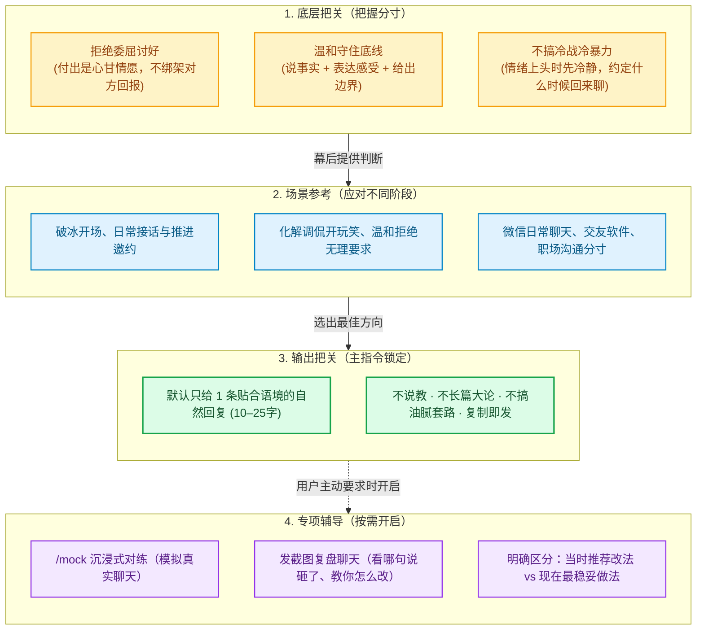
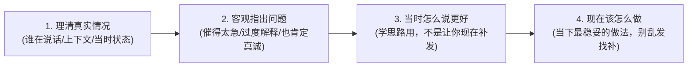

<div align="center">

# 💘 Emotional Push & Pull｜情感推拉

**高情商、不卑不亢、有边界的日常聊天与相处指南**  
*日常聊天直接给自然回复 · 发截图教你怎么改 · 1对1实战模拟对练*

<br/>

[](README.md)
[](.agents/skills/emotional-master)
[](evals/scenarios.json)
[](evals/eval_report.md)
[](.agents/skills/emotional-master/SKILL.md)
[](LICENSE)

<br/>

[为什么做这个](#-为什么做这个) • [怎么运作的](#️-怎么运作的) • [发截图复盘](#-发截图看哪句说砸了怎么改) • [日常实用速查](#-日常实用速查) • [知识库全景](#-18-个实用手册目录) • [场景实测验证](#-30-个聊天场景实测)

</div>

---

## 💡 为什么做这个

平时和女生聊天，很多男生容易走两个极端：
- **要么太客气变成老好人**：一味讨好迎合、默默付出，对方回得慢就患得患失，最后把自己搞得很累；
- **要么学网上那些油腻套路**：盲目打压、强行装酷，一张嘴就显得油嘴滑舌，让人反感。

**Emotional Push & Pull** 就是为了解决这些日常沟通的实际问题：  
不用死记硬背套路话术，也不需要长篇大论的心理学理论。帮你在保持真诚和个人原则的前提下，**接得舒服、聊得松弛**，遇到不合适的人也能体面退场。

> [!TIP]
> **日常使用原则：**  
> 平时直接发原话或发截图，系统**默认只给 1 条 10–25 字即拷即用的自然回复**，直接复制就能发。不讲大道理、不搞说教；只有你主动问“为什么 / 帮我复盘”或者输入 `/mock` 时，才会展开细讲。

---

## 🏛️ 怎么运作的

为了保证日常回复干净利落，不啰嗦、不说教，系统在内部做了分工：



| 模块分工 | 负责什么 | 包含文件 | 实际效果 |
| :--- | :--- | :--- | :--- |
| **底层原则** | 树立健康心态：不卑不亢、温和设限、情绪成熟 | [`mindset_meta_concepts.md`](.agents/skills/emotional-master/references/mindset_meta_concepts.md) | 在后台把握回复分寸，平时不把理论抛给用户 |
| **场景手册** | 开场、接话、化解尴尬、推进邀约、处理分歧 | [`chat_playbook.md`](.agents/skills/emotional-master/references/chat_playbook.md) 等 12 篇手册 | 针对不同场景提供贴地气的说话思路 |
| **日常输出** | 极简短打，杜绝废话与套路 | [`SKILL.md`](.agents/skills/emotional-master/SKILL.md) | **系统总控**：平时默认给 1 句话，直接发出去 |
| **实战辅导** | 1对1模拟对练、聊天截图复盘打分 | [`screenshot_dialogue_review.md`](.agents/skills/emotional-master/references/screenshot_dialogue_review.md)<br/>[`crush_sandbox_simulator.md`](.agents/skills/emotional-master/references/crush_sandbox_simulator.md) | 输入 `/mock` 或发截图让复盘时才展开辅导 |

---

## 📸 发截图：看哪句说砸了、怎么改

聊完之后心里没底？不知道哪句话说错了，或者发完没回想找补？直接把聊天截图或文字发过来，系统会从这四点帮你理清楚：



### 📋 复盘示例效果

> **整体看法：**  
> 前面聊得挺好，你主动约她也大大方方。但后面两个小时里连续催了两次，显得有点急躁，给对方施加了回复压力。
> 
> **关键复盘：**  
> - 原话：“怎么不理我了？在忙什么这么神秘？”  
>   → **问题**：追着要回应，容易显得患得患失。  
>   → **当时更好的改法**：留白不催，或者换个轻松话题：“刚忙完汇报，今天这天真是太热了。” *(备选：“周末那家展听说评价挺好，改天碰上了带你去看”)*
> 
> **做得好的地方：**  
> - 原话：“周六下午有空吗？我知道一家很棒的咖啡馆想约你尝尝。” → 表达直接坦荡，想约就大大方方约，绝对不是讨好。
> 
> **现在该怎么做：**  
> 先停下来，不要再发任何解释、表情包或认错小作文。把手机放一边做自己的事，等她回复；如果一两天都没回，之后重新挑个轻松日常话题再聊。

---

## 🎛️ 日常实用速查

平时不需要记复杂的指令，直接把聊天原话或截图丢过来就行。需要对练或专项指导时，可以用这些常见用法：

| 使用场景 | 你可以这样问 / 输入示例 | 系统怎么回你 | 怎么开启 |
| :--- | :--- | :--- | :--- |
| **日常求救接话** | “她说：‘你挺闲啊’，我们平时常开玩笑，怎么回？” | `忙里偷闲，刚好碰上你。`<br>*(10–25字自然接话，不讲大道理)* | 直接发原话 |
| **看截图挑问题** | 发送聊天截图 + “帮我看看这段聊天，哪句说得不好？当时怎么改？现在怎么做？” | 给出清晰复盘：**客观定性 + 当时改法 + 肯定好的地方 + 告诉你现在别乱动** | 发截图或说 `/复盘聊天` |
| **面对越界或绑架** | “她说：‘你要是不把朋友圈背景换成我，就是不爱我’，怎么回？” | `我很在乎你，但我习惯按自己的节奏发动态，我们不拿这个证明爱。` | 直接发原话 |
| **1对1聊天模拟** | 想提前找找感觉，练习跟不同性格的女生聊天 | 模拟真实对话，对方会根据你的回复给出真实的反应和心理反馈 | `/mock 慢热型`<br/>`/mock 职场型`<br/>`/mock 活泼型` |
| **模拟过程中的求助** | 对练时卡壳了、不知道怎么接，或者想退出 | 随时暂停角色给出提示，或者生成体检报告 | `/提示` *(给思路示范)*<br/>`/教练` *(开启每轮短评)*<br/>`/复盘` *(查看整场表现)*<br/>`/exit` *(随时退出)* |

---

## 🛠️ 18 个实用手册目录

系统内建的 18 个专项参考资料，按解决的实际问题存放在 [`.agents/skills/emotional-master/references/`](.agents/skills/emotional-master/references/)：

| 类别 | 模块名称 | 解决什么问题 | 查看对应文件 |
| :--- | :--- | :--- | :--- |
| **核心规则** | **主控准则** | 系统总入口，锁定极简回复风格，防止废话 | [`SKILL.md`](.agents/skills/emotional-master/SKILL.md) |
| **心态分寸** | **健康沟通心态** | 破除讨好心态、学会温和拒绝、吵架时不冷暴力 | [`mindset_meta_concepts.md`](.agents/skills/emotional-master/references/mindset_meta_concepts.md) |
| **日常聊天** | **聊天实战手册** | 破冰开场、找话题、制造共鸣、怎么自然约人 | [`chat_playbook.md`](.agents/skills/emotional-master/references/chat_playbook.md) |
| | **接梗与化解调侃** | 应对女生开玩笑、识破试探、温和守住自己的边界 | [`shit_tests_bible.md`](.agents/skills/emotional-master/references/shit_tests_bible.md) |
| | **吵架冷静与复原** | 情绪上头时怎么暂停、冷战怎么破冰、失恋后体面调整 | [`recovery_and_cold_start.md`](.agents/skills/emotional-master/references/recovery_and_cold_start.md) |
| | **女生想法与情绪** | 读懂字面背后的情绪、理解对方的安全感与聊天节奏 | [`female_psychology.md`](.agents/skills/emotional-master/references/female_psychology.md) |
| | **松弛推拉技巧** | 告别死板迎合，学会幽默曲解、适度留白与情绪起伏 | [`push_pull_framing.md`](.agents/skills/emotional-master/references/push_pull_framing.md) |
| | **进阶分寸与互动** | 识别对方好感信号、约会肢体互动的分寸与尊重底线 | [`signals_and_kino.md`](.agents/skills/emotional-master/references/signals_and_kino.md) |
| | **深层话题沟通** | 聊完日常后怎么聊三观、聊经历，不做查户口式拷问 | [`advanced_conversation_steering.md`](.agents/skills/emotional-master/references/advanced_conversation_steering.md) |
| | **不同平台聊天指南** | 微信日常聊法、交友软件破冰、同事故意划清界限 | [`platform_playbooks.md`](.agents/skills/emotional-master/references/platform_playbooks.md) |
| | **高情商接话金句** | 常见玩笑幽默化解金句、反向曲解金句库 | [`tong_classic_quotes.md`](.agents/skills/emotional-master/references/tong_classic_quotes.md) |
| | **真实对话案例** | 多轮真实情境聊天案例与去敏实录参考 | [`real_world_dialogue_examples.md`](.agents/skills/emotional-master/references/real_world_dialogue_examples.md) |
| **复盘对练** | **截图复盘与改法** | 分析聊天截图，指出问题、给改法、教当下怎么做 | [`screenshot_dialogue_review.md`](.agents/skills/emotional-master/references/screenshot_dialogue_review.md) |
| | **1对1对练沙盒** | 扮演各种性格的女生陪你练，即时指点提升 | [`crush_sandbox_simulator.md`](.agents/skills/emotional-master/references/crush_sandbox_simulator.md) |
| | **逐轮副驾指导** | 每次回复提供两种备选方案与节奏建议（辅导模式） | [`autopilot_live_guide.md`](.agents/skills/emotional-master/references/autopilot_live_guide.md) |
| **个人形象** | **朋友圈与头像诊断** | 头像、签名、朋友圈日常动态诊断，避开装逼雷区 | [`profile_audit_rules.md`](.agents/skills/emotional-master/references/profile_audit_rules.md) |
| | **展示真实生活** | 怎么在朋友圈自然呈现真实工作与爱好，不刻意摆拍 | [`social_profile_moments.md`](.agents/skills/emotional-master/references/social_profile_moments.md) |
| | **对象理性观察卡** | 帮你看清对方的真实人品与三观，不盲目加滤镜 | [`target_profile_card.md`](.agents/skills/emotional-master/references/target_profile_card.md) |

<details>
<summary><b>📂 点击展开完整工程文件与代码目录</b></summary>

```text
emotional-push-pull/
├── .agents/skills/emotional-master/          # 主技能目录
│   ├── SKILL.md                              # 总控准则（极简输出、分流规则）
│   └── references/                           # 18 个实用参考手册
│       ├── screenshot_dialogue_review.md     # 截图复盘与表达修正指南
│       ├── mindset_meta_concepts.md          # 底层原则：隐性契约、边界、情绪主权
│       ├── chat_playbook.md                  # 聊天实战：破冰、升温、邀约三步走
│       ├── shit_tests_bible.md               # 调侃化解与三步设限实操
│       ├── recovery_and_cold_start.md        # 吵架暂停与关系调整
│       ├── female_psychology.md              # 女生沟通心理与情绪承接
│       ├── push_pull_framing.md              # 松弛感与高框架推拉
│       ├── signals_and_kino.md               # 信号识别与身体接触分寸
│       ├── advanced_conversation_steering.md # 深度话题展开与自然留白
│       ├── crush_sandbox_simulator.md        # /mock 沉浸式对练沙盒
│       ├── autopilot_live_guide.md           # 逐轮副驾驶实时指导
│       ├── real_world_dialogue_examples.md   # 真实对话场景参考
│       ├── platform_playbooks.md             # 微信/交友软件/职场分寸
│       ├── profile_audit_rules.md            # 头像/签名/朋友圈诊断
│       ├── social_profile_moments.md         # 真实生活方式朋友圈打造
│       ├── target_profile_card.md            # 理性观察卡：分清事实与脑补
│       └── tong_classic_quotes.md            # 幽默化解与高自尊金句库
├── evals/                                    # 场景测试目录
│   ├── scenarios.json                        # 30 个典型聊天场景定义
│   ├── eval_report.md                        # 实测报告与成对对比记录
│   └── fixtures/                             # 真实聊天截图测试图库
│       ├── blurry_unclear_message.png        # 模糊文字测试
│       ├── complex_cross_day_chat.png        # 跨天长对话测试
│       ├── complex_missing_context.png       # 缺失上下文测试
│       ├── complex_quoted_reply.png          # 多条引用回复测试
│       ├── overlap_shot_part1.png            # 拼接截图重叠部分A
│       └── overlap_shot_part2.png            # 拼接截图重叠部分B
├── open_source_reference/                    # 开源参考资料归档
├── LICENSE                                   # 本项目开源协议 (MIT)
└── README.md                                 # 本说明文档
```

</details>

---

## 🧪 30 个聊天场景实测

为了防止“纸上谈兵”或现场翻车，项目在 [`evals/scenarios.json`](evals/scenarios.json) 中设定了 **30 个真实场景测试**，并在 [`evals/eval_report.md`](evals/eval_report.md) 中记录了实际表现。**全部 30 个场景测试均已通过 🟢**：

| 场景类别 | 测了哪些常见情况 | 核心要求（必须做到 / 坚决不做） | 测试结果 |
| :--- | :--- | :--- | :---: |
| **日常聊天接话** | 刚认识打招呼、对方只回“嗯嗯”、普通同学帮忙办事、认真被问是否想交往、迟到失误道歉、不秒回不套路等 | 优先给 1 句简短自然回复；**不随便瞎猜对方好感度**；不把女生礼貌感谢当成喜欢；认错就坦荡道歉，不硬撑面子 | `🟢 PASS` |
| **守住底线与情绪** | 被要求换头像证明爱、情绪上头快吵架、为对方推了工作被冷落等 | 面对情感绑架温和表明底线；**快吵架时主动暂停并说好什么时候回来聊，不搞冷战**；不发自我感动的小作文被动攻击 | `🟢 PASS` |
| **截图挑刺与复盘** | 正常邀约被误判为舔狗、真诚道歉被误判为示弱、两小时连发催回复、刚加好友就油腻调侃等 | **肯定真诚主动，主动约人不是舔狗**；指出连催的施压感；刚认识别油腻开黄腔；被明确拒绝后坚决不再纠缠 | `🟢 PASS` |
| **复杂截图识别** | 微信左右气泡分不清谁在说话、多张截图重叠发、文字模糊看不清、引用消息混乱等 | 准确分清哪边是男生哪边是女生；多图去重；**看不清的文字直接标明确认不了，坚决不瞎猜脑补** | `🟢 PASS` |

> [!NOTE]
> 想了解成对对比（同一句话在不同情境下的截然不同定性，比如“正常约一次 vs 连续催着约”）以及具体实测问答，可直接查看 [**《30 场景实际行为验收与成对对照测试报告》**](evals/eval_report.md)。

---

## 📄 许可证与开源声明

1. **自研内容**：主指令 [`SKILL.md`](.agents/skills/emotional-master/SKILL.md)、18 个重构参考指南、测试场景集及测试报告均采用 [MIT License](LICENSE) 开源。
2. **第三方参考归档**：[`open_source_reference/`](open_source_reference/) 目录下的资料保留原项目作者版权与原协议，独立存放。

---

<div align="center">
  <sub>不卑不亢 · 自然真诚 · 聊得舒服 · 保持自尊</sub>
</div>
