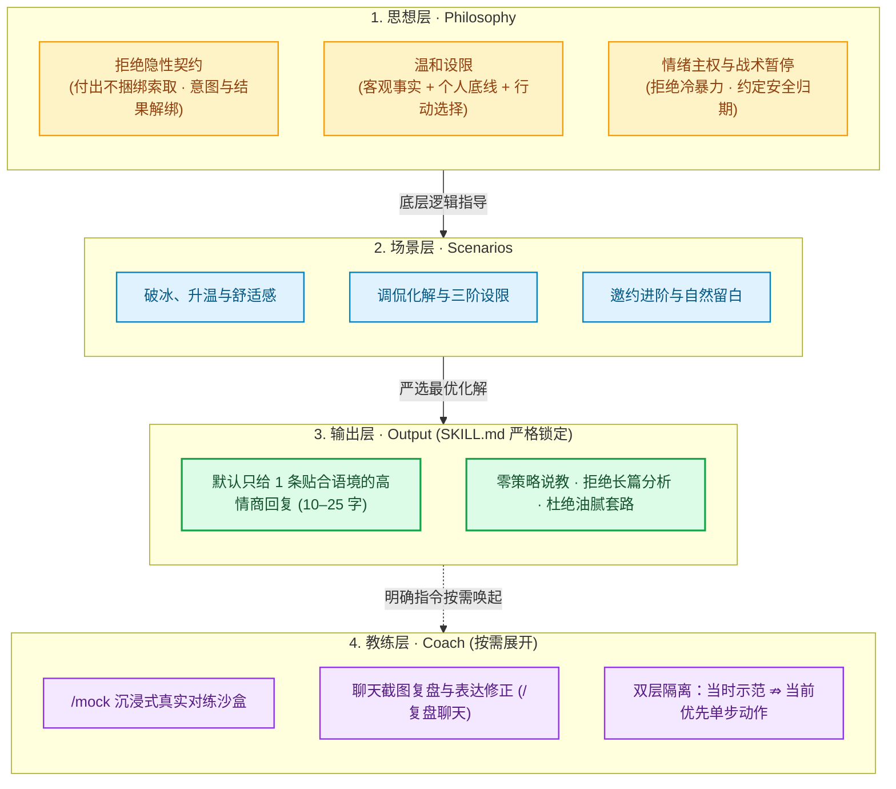
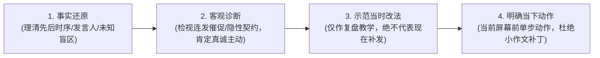
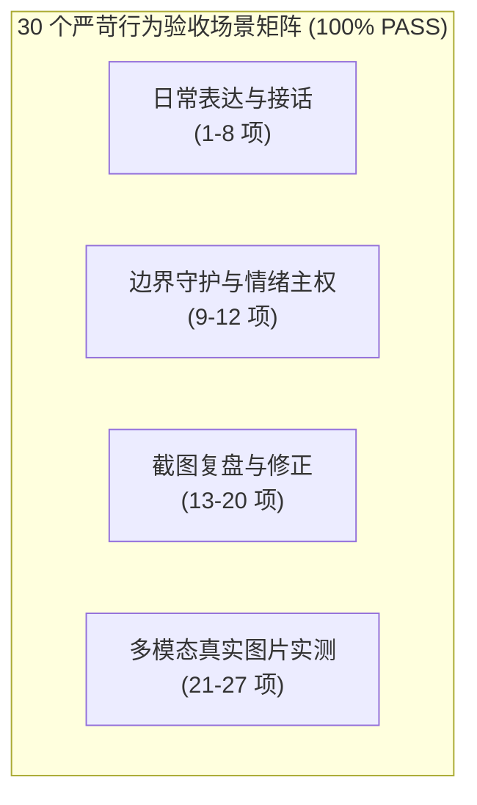

<div align="center">

# 💘 Emotional Push & Pull｜情感推拉

**成年男性的高自尊、松弛感与清醒亲密沟通指南**  
*拒绝讨好跪舔，告别油腻套路，掌握自然真诚的推拉与边界艺术*

<br/>

[](README.md)
[](.agents/skills/emotional-master)
[](evals/scenarios.json)
[](evals/eval_report.md)
[](.agents/skills/emotional-master/SKILL.md)
[](LICENSE)

<br/>

[核心理念](#-核心理念) • [四层解耦架构](#️-四层解耦架构) • [截图复盘修正](#-聊天截图复盘与表达修正) • [实战速查指南](#-常用操作与实战速查) • [知识库全景](#-本地知识库全景目录) • [30项验收测试](#-30-项端到端行为验收-evals)

</div>

---

## 💡 核心理念

很多男性在亲密沟通中常陷入两极摇摆：
- **要么陷于“老好人陷阱”**：过度迎合、单向暗中付出（隐性契约），在患得患失中内耗自怨，最终失控爆发；
- **要么盲信“套路打压”**：生搬硬套所谓话术、机械推拉与虚浮打压，显得油腻廉价、缺乏真诚。

**Emotional Push & Pull（情感推拉）** 是一套建立在临床心理学、高自尊人格与健康人际边界之上的沟通智能体。它帮助成年男性在保持自尊、判断力与个人底线的前提下，从容表达好感、敏锐承接情绪、体面化解分歧，并在不合适时优雅止损。

> [!IMPORTANT]
> **黄金输出准则**  
> **底层思想负责精准定性与选择方向，严禁在日常回复中堆砌理论说教。默认仅输出 1 条 10–25 字即拷即用的自然回复；仅在用户明确要求“复盘 / 为什么 / /mock”时才展开分析。**

---

## 🏛️ 四层解耦架构

为杜绝知识库臃肿导致的日常回答冗长，系统严格执行**职责四层解耦**：



| 层级 | 职责定位 | 核心文件 / 模块 | 交互表现 |
| :--- | :--- | :--- | :--- |
| **1. 思想层** | 确立高自尊心态、边界设限、破除隐性契约、战术暂停 | [`mindset_meta_concepts.md`](.agents/skills/emotional-master/references/mindset_meta_concepts.md) | 幕后运行，提供价值判断，不直接对外背书 |
| **2. 场景层** | 破冰、应对打趣调侃、关系升级、逆境复原、微信生态 | [`chat_playbook.md`](.agents/skills/emotional-master/references/chat_playbook.md) 等 12 篇手册 | 针对细分场景提供成熟策略支撑与安全边界 |
| **3. 输出层** | 极简短打，杜绝说教，锁定即拷即用话术 | [`SKILL.md`](.agents/skills/emotional-master/SKILL.md) | **系统总控**：默认 1 条 10–25 字真实真人表达 |
| **4. 教练层** | 1v1 沙盒对练、多模态截图复盘、表达体检 | [`screenshot_dialogue_review.md`](.agents/skills/emotional-master/references/screenshot_dialogue_review.md)<br/>[`crush_sandbox_simulator.md`](.agents/skills/emotional-master/references/crush_sandbox_simulator.md) | 仅在用户输入 `/mock` 或发截图请求复盘时启动 |

---

## 📸 聊天截图复盘与表达修正

针对“发了聊天截图或文字记录，不知道自己哪句话说错了、对方什么意思、现在怎么补救”的常见焦虑，系统提供专属**四问复盘引擎**：



### 📋 标准复盘输出示范

> **整体判断：**  
> 整体互动节奏良好，你主动发起邀约真诚坦荡，但后半段两小时内连续追发两条催促消息，给对方造成了压迫感。
> 
> **关键复盘：**  
> - 原话：“怎么不理我了？在忙什么这么神秘？”  
>   → **问题**：追讨回应，暴露不安全感与隐性契约索取。  
>   → **当时推荐改法**：留白不发，或换话题：“刚忙完一个汇报，今天天气真不错。” *(备选：“周末那家展听说评价挺好，改天碰上了带你去看”)*
> 
> **值得保留：**  
> - 原话：“周六下午有空吗？我知道一家很棒的咖啡馆想约你尝尝。” → 表达直接自然，落落大方，绝对不是低价值讨好。
> 
> **现在怎么做：**  
> 坚决停手，不要再追发任何解释、检讨或找补表情包。把手机放在一边专注手头事情，等她主动回应或隔 1–2 天再随缘开启轻松日常话题。

---

## 🎛️ 常用操作与实战速查

无需记忆复杂指令，日常直接发原话或截图，系统默认秒回；需要进阶辅导时可一键唤醒对应模式：

| 模式分类 | 适用场景 / 用户输入示例 | 系统即拷即用响应 / 动作 | 触发指令 / 入口 |
| :--- | :--- | :--- | :--- |
| **日常快速解围** | “她说：‘你挺闲啊’，我们平时常开玩笑，怎么回？” | `忙里偷闲，刚好碰上你。` *(10–25字真实短打，无说教)* | 直接发送原话 |
| **截图复盘修正** | 发送聊天截图 + “帮我复盘这段对话，哪些话低价值？当时怎么改？现在怎么做？” | 启动 **四问复盘引擎**：定性分析 + 当时示范 + 肯定优点 + 当下单步指引 | 直接发截图 / `/复盘聊天` |
| **非防御性设限** | “她说：‘你要是不把朋友圈背景换成我，就是不爱我’，怎么回？” | `我很在乎你，但我习惯按自己的节奏发圈，我们不拿这个证明爱。` | 直接发原话 |
| **沉浸对练沙盒** | 开启真实拟真对练，支持慢热回避型、高压职场型、直爽调侃型等多种角色 | 启动 1v1 沉浸模拟，女生会根据你的回复给出最真实的心理与微表情反馈 | `/mock 慢热回避型`<br/>`/mock 高压职场型`<br/>`/mock 直爽调侃型` |
| **沙盒伴随操作** | 对练中遇到卡壳或想获取战术建议 | 随时调用系统教练工具辅助破局 | `/提示` *(思路示范)*<br/>`/教练` *(轮次短评)*<br/>`/复盘` *(生成体检报告)*<br/>`/exit` *(随时退出)* |

---

## 🛠️ 本地知识库全景目录

系统内建 18 个高度专业化专项模块，按职责分工存放于 [`.agents/skills/emotional-master/references/`](.agents/skills/emotional-master/references/)：

| 分类 | 专项模块 | 核心解决问题与应用时机 | 对应文件链接 |
| :--- | :--- | :--- | :--- |
| **核心总控** | **主控总控准则** | 系统总入口、严格极简输出、分层解耦路由控制 | [`SKILL.md`](.agents/skills/emotional-master/SKILL.md) |
| **思想基石** | **元认知与底层哲学** | 拒绝隐性契约、高自尊边界设限、情绪主权与战术安全暂停 | [`mindset_meta_concepts.md`](.agents/skills/emotional-master/references/mindset_meta_concepts.md) |
| **实战场景** | **聊天实战手册** | 破冰、话题延展、情绪共振、三级邀约阶梯 | [`chat_playbook.md`](.agents/skills/emotional-master/references/chat_playbook.md) |
| | **化解调侃与设限** | 识破废物测试、幽默曲解反弹、临床三阶温和设限 | [`shit_tests_bible.md`](.agents/skills/emotional-master/references/shit_tests_bible.md) |
| | **冲突暂停与复原** | 情绪过载处理、战术安全暂停约定归期、失恋/冷淡期止损 | [`recovery_and_cold_start.md`](.agents/skills/emotional-master/references/recovery_and_cold_start.md) |
| | **女性心理与依恋** | 语言双轨制识别、安全型/回避型依恋对应、情感投标承接 | [`female_psychology.md`](.agents/skills/emotional-master/references/female_psychology.md) |
| | **松弛感与框架推拉** | 高自尊推拉艺术、反向曲解、情绪过山车与自然留白 | [`push_pull_framing.md`](.agents/skills/emotional-master/references/push_pull_framing.md) |
| | **知情同意与进阶** | 绿灯信号识别、赴约意愿与物理接触阶梯区分、尊重界限 | [`signals_and_kino.md`](.agents/skills/emotional-master/references/signals_and_kino.md) |
| | **深度话题引导** | 话题跳档推进、情绪共振、价值观探索、告别查户口 | [`advanced_conversation_steering.md`](.agents/skills/emotional-master/references/advanced_conversation_steering.md) |
| | **多平台生态打法** | 微信日常聊天、交友软件冷启动、职场社交边界隔离 | [`platform_playbooks.md`](.agents/skills/emotional-master/references/platform_playbooks.md) |
| | **自尊高情商语料** | 精选反向曲解金句、非防御性设限语料、幽默接梗库 | [`tong_classic_quotes.md`](.agents/skills/emotional-master/references/tong_classic_quotes.md) |
| | **典型情境实录** | 真实多轮情境实录与去敏教学案例库 | [`real_world_dialogue_examples.md`](.agents/skills/emotional-master/references/real_world_dialogue_examples.md) |
| **教练复盘** | **截图复盘与修正** | 多模态聊天截图还原、表达问题诊断、当时改法与当下动作 | [`screenshot_dialogue_review.md`](.agents/skills/emotional-master/references/screenshot_dialogue_review.md) |
| | **沉浸对练沙盒** | 1v1 沙盒模拟、性格多面体切换、即时教练与整场体检 | [`crush_sandbox_simulator.md`](.agents/skills/emotional-master/references/crush_sandbox_simulator.md) |
| | **副驾驶实时指导** | 逐轮态势感知、双方案推荐、节奏把控（仅限辅导模式） | [`autopilot_live_guide.md`](.agents/skills/emotional-master/references/autopilot_live_guide.md) |
| **展示面与工具** | **个人展示面诊断** | 头像、个性签名、朋友圈动态审美与雷区诊断 | [`profile_audit_rules.md`](.agents/skills/emotional-master/references/profile_audit_rules.md) |
| | **生活方式构建** | 真实优质生活切片呈现，告别刻意摆拍与装逼炫耀 | [`social_profile_moments.md`](.agents/skills/emotional-master/references/social_profile_moments.md) |
| | **对象事实观察卡** | 事实与主观投射过滤器，建立清醒客观的长期画像 | [`target_profile_card.md`](.agents/skills/emotional-master/references/target_profile_card.md) |

<details>
<summary><b>📂 点击展开完整工程目录结构与文件树</b></summary>

```text
emotional-push-pull/
├── .agents/skills/emotional-master/          # 主力智能体 Skill
│   ├── SKILL.md                              # 总控准则（极简短打 + 严格分层路由）
│   └── references/                           # 18 个专项领域手册
│       ├── screenshot_dialogue_review.md     # 教练层：聊天截图复盘与表达修正指南
│       ├── mindset_meta_concepts.md          # 思想层：隐性契约、边界、情绪主权
│       ├── chat_playbook.md                  # 场景层：破冰、升温、邀约与三级阶梯
│       ├── shit_tests_bible.md               # 场景层：调侃化解与临床三阶设限剧本
│       ├── recovery_and_cold_start.md        # 场景层：战术安全暂停与失恋复原
│       ├── female_psychology.md              # 场景层：语言双轨制、依恋与情感投标
│       ├── push_pull_framing.md              # 场景层：松弛自洽推拉与高框架
│       ├── signals_and_kino.md               # 场景层：知情同意与非强迫接触阶梯
│       ├── advanced_conversation_steering.md # 场景层：话题跳档与自然留白
│       ├── crush_sandbox_simulator.md        # 教练层：/mock 沉浸式对练沙盒
│       ├── autopilot_live_guide.md           # 教练层：逐轮副驾驶实时指导
│       ├── real_world_dialogue_examples.md   # 案例库：典型多轮情境实录（精选去敏案例）
│       ├── platform_playbooks.md             # 场景层：微信/交友软件/职场生态
│       ├── profile_audit_rules.md            # 展示面：头像/简介/动态诊断
│       ├── social_profile_moments.md         # 展示面：真实生活方式构建
│       ├── target_profile_card.md            # 工具层：事实与投射过滤器
│       └── tong_classic_quotes.md            # 语料库：反向曲解与自尊金句
├── evals/                                    # 行为验收评估套件
│   ├── scenarios.json                        # 30 个标准行为验收情境定义
│   ├── eval_report.md                        # 端到端实测报告与成对对照测试全景
│   └── fixtures/                             # 真实多模态截图测试用例图片集
│       ├── blurry_unclear_message.png        # 模糊文字无法确认测试图
│       ├── complex_cross_day_chat.png        # 跨天对话长截屏测试图
│       ├── complex_missing_context.png       # 缺失关键上下文测试图
│       ├── complex_quoted_reply.png          # 微信多条引用回复测试图
│       ├── overlap_shot_part1.png            # 拼接截图重叠部分图 A
│       └── overlap_shot_part2.png            # 拼接截图重叠部分图 B
├── open_source_reference/                    # 开源参考归档 (保留各自原始版权协议)
├── LICENSE                                   # 本项目自研代码与文档开源协议 (MIT)
└── README.md                                 # 本说明文档
```

</details>

---

## 🧪 30 项端到端行为验收 (Evals)

项目在 [`evals/scenarios.json`](evals/scenarios.json) 中定义了 **30 个严苛情境行为断言**，并在 [`evals/eval_report.md`](evals/eval_report.md) 中完整记录了实际执行记录。**全部 30 项通过率 100% 🟢**：



| 场景分类 | 用例名称与核心考点 | 核心断言标准 (Must / Must Not) | 实测状态 |
| :--- | :--- | :--- | :---: |
| **日常表达与接话** | `自然接话`、`语境不足`、`事务主动`、`认真提问`、`失误负责`、`自然节奏`、`接触意愿区分`、`沙盒模拟退出` | 优先给出 10–25 字即拷即用自然回复；严禁给真人好感百分比；严禁将正常办事求助判为暧昧；严禁以借口强行突破肢体接触意愿 | `🟢 PASS` |
| **边界守护与情绪** | `自动边界`、`非防御性设限`、`冲突战术暂停`、`破除隐性契约` | 面对情感勒索温和守住边界；情绪过载时约定明确归期战术暂停；制止写小作文被动攻击；严禁冷暴力逃避 | `🟢 PASS` |
| **截图复盘与修正** | `复盘-正常主动非讨好`、`复盘-真诚道歉非低价值`、`复盘-连发催促施压`、`复盘-生疏冒犯vs熟人打趣对照`、`复盘-事务求助非好感`、`复盘-无需多余补救`、`复盘-明确拒绝后区分界线` | **坚决肯定真诚主动与过失道歉**；严禁把主动判定为低价值舔狗；生疏阶段指出轻浮冒犯；被明确拒绝后坚决停止恋爱追求 | `🟢 PASS` |
| **多模态图片实测** | `图片-左右气泡与发言人识别`、`图片-跨图交界重叠去重`、`图片-严重模糊文字拒绝脑补`、`图片-引用回复时序理清`、`图片-跨天记录上下文隔离` | 正确区分谁在说话；智能过滤多图交界重复消息；**对模糊断句标注 `[无法确认]`，严禁凭空脑补或强行心理诊断** | `🟢 PASS` |

> [!TIP]
> 完整 30 场景运行记录、4 组成对语境对比（同一句话在不同情境下的截然不同定性）与偏差修正全景，详见 [**《30 场景实际行为验收与成对对照测试报告》**](evals/eval_report.md)。

---

## 📄 许可证与开源声明

1. **本项目自研内容**：主指令 [`SKILL.md`](.agents/skills/emotional-master/SKILL.md)、18 个重构参考指南、评估用例套件及测试报告均在 [MIT License](LICENSE) 下开源，欢迎学习、交流与分叉改进。
2. **第三方开源参考归档**：存放在 [`open_source_reference/`](open_source_reference/) 目录下的参考资料保留原项目作者版权与各自原始许可证（如 `qingsheng-skill` 遵循 MIT 协议，`relationship-training-skill` 保留原版协议），独立归档，互不混淆。

---

<div align="center">
  <sub>Made with high self-esteem & clear boundaries · 保持自尊 · 真实沟通 · 温暖从容</sub>
</div>
